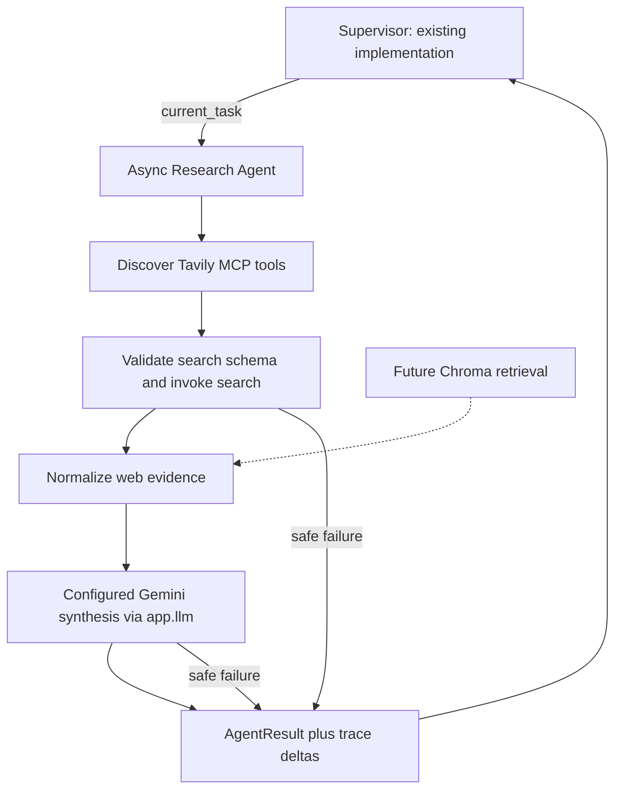

# Architecture and implementation status

## Scope and assignment basis

Reviewed the complete `Assignment_2_Description.pdf`, including sections 2–7 and the rubric. No separate TA clarification file was found. This step implements Tavily Remote MCP and the web Research Agent only. It does not complete the assignment: Chroma RAG, the other specialized workers, application streaming, evaluation, deployment, and exercised MCP sharing remain pending.

## Current execution flow



`app/services/tavily_mcp.py` owns transport, MCP discovery/invocation, and source normalization. It exposes `await search_web(query)` with optional settings injection for tests. Connection setup, discovery and evidence extraction are straightforward functions; no retriever class is needed. It has no LangGraph dependency and can be called by future workers. `research.py` owns delegated-task validation, evidence augmentation, generation and result/trace mapping. `llm.py` remains the sole provider factory; existing configured model defaults are preserved.

### MCP lifecycle and authentication

Each search creates an HTTP client, opens Streamable HTTP, initializes a low-level MCP ClientSession, discovers tools across bounded pages, selects a web-search capability with a string query input, validates arguments against its advertised JSON schema, invokes the tool, and closes session/transport/client in reverse order. A canonical Tavily search name is preferred only among compatible capabilities. Missing or ambiguous tools fail explicitly. This uses installed MCP 2.3.0: `streamable_http_client` returns two streams and accepts an `httpx2` client. No adapter or direct Tavily SDK is required.

Endpoint: `https://mcp.tavily.com/mcp/?tavilyApiKey=<encoded-key>`. Query authentication follows assignment sections 2.5 and 3.4; Tavily also documents bearer authentication, but this implementation follows the assignment. Known SDK endpoint loggers redact Tavily URLs and suppress sensitive Tavily tracebacks, including cached traceback text. Unrelated exception diagnostics are preserved. Public failures never include raw upstream exception text. Do not enable raw HTTP wire tracing or export credential-bearing URLs to external tracing systems; logger coverage is not universal instrumentation redaction.

A per-search session avoids global mutable connection state and cross-task cancellation issues. It costs a handshake/discovery per task. Pooling, OAuth and a generic MCP server registry are unnecessary at this stage. The same service can be reused by another worker, but reusable code alone does not satisfy the rubric's requirement that two agents actually invoke the same MCP tool.

### Evidence and research

Accept structured MCP content or JSON text content. Normalize usable HTTP(S) sources into `source_id`, `title`, `url`, `content`, and metadata (score, publication date, author where provided). Deduplicate exact URLs; cap result count and prompt snippet length. Reject malformed payloads and unusable nonempty results; empty searches are handled as failed research without asking the model to invent evidence.

The Research Agent receives `current_task.instruction`, retrieves evidence, and asynchronously calls the configured research LLM (`google` / `gemini-2.5-flash` by default). The prompt distinguishes evidence, interpretation and uncertainty and treats source content as untrusted. Gemini text and text-block responses are supported. Sources and snippets are preserved in an optional structured result field. A compact title/URL source appendix preserves provenance for consumers of `content` without duplicating all evidence snippets in supervisor context. An appendix does not validate claim-level citations; inline citation accuracy remains a limitation.

### LangGraph contracts and failure handling

Existing `AgentResult` required fields are unchanged. Optional `sources` and `TraceEvent.tool` fields extend the contracts. Nodes return only new result and trace entries to avoid duplicating append-reducer state. Research traces identify the worker, selected tool, provider/model, actions and rationale. Model-start events distinguish intended routing from successful completion. The research routing rationale explicitly describes configured task-based assignment, not completed dynamic routing.

Missing credentials, bad tasks, connection/tool/schema/payload errors, empty evidence and LLM failures become `success=False` results. Retrieved sources survive a synthesis failure. MCP operations have a total timeout (default 30s); synthesis has a separate timeout (default 60s). Cancellation propagates so callers can disconnect without leaving generation running. There are no automatic search retries that might consume quota repeatedly. Existing provider retries remain unchanged.

Async research requires graph `ainvoke`/`astream`; a synchronous graph call cannot run this node. The production graph currently cannot import because Code and Summary modules are missing. Failure isolation was verified in a small real LangGraph containing the research worker and a recovery supervisor, not in the incomplete production graph.

## Configuration and validation

`.env.example` now names the role-specific provider/model fields consumed by `Settings`. Legacy `OPENAI_MODEL` and `GEMINI_MODEL` are not consumed by the role-based configuration; use `SUPERVISOR_MODEL`, `CODE_MODEL`, `RESEARCH_MODEL`, and `SUMMARY_MODEL`. Existing `.env` is untouched. Fixed `validate_runtime` references to nonexistent settings and its handling of None credentials. The method is not currently called by application startup; add validation when the operational chat path is wired, without requiring credentials for foundation-only health tests.

## Tests and exact PowerShell commands

From repository root:

```powershell
.\.venv\Scripts\python.exe -m pytest -q -rs -p no:cacheprovider
.\.venv\Scripts\python.exe -m pip check
$env:RUN_LIVE_MCP = '1'
.\.venv\Scripts\python.exe -m pytest tests/test_research_mcp.py -m live -q -rs -p no:cacheprovider
Remove-Item Env:\RUN_LIVE_MCP
.\.venv\Scripts\python.exe -m uvicorn app.main:app --reload
```

For live testing, set `TAVILY_API_KEY` in the environment or local ignored `.env`; it consumes real quota. Default pytest selection excludes live tests even if credentials and RUN_LIVE_MCP are present. Explicit live execution requires both `-m live` and `RUN_LIVE_MCP=1`; obtain approval before making paid calls. The live test limits search results to one and makes no LLM calls. It uses application `Settings`, which reads the project `.env` and environment overrides; mocked testing verifies `.env` loading without exposing a real key. Deterministic tests mock MCP and LLM calls, covering lifecycle/auth encoding, discovery/pagination/selection, schema validation, structured/text payloads, malformed/empty results, metadata/citations, deduplication, deadlines, connection/tool/LLM failure, log redaction, provider traces, content blocks, configuration validation and graph failure recovery.

Latest offline verification: **42 passed, 1 deselected, 0 skipped**; `pip check`: no broken requirements. Added checks cover sensitive/cached traceback redaction, unrelated diagnostics, application `.env` loading in the mocked live-test wrapper, cancellation/cleanup, empty-evidence cost avoidance, and compact citation preservation. No live API test was run during this review. The earlier implementation run reported 34 passed and one skipped live test; that skip did not verify connectivity. Live Tavily authentication/discovery/payload compatibility, real Gemini generation, Cloud Run deployment and full production graph execution remain unverified.

## Remaining RAG integration

Next add a non-toy technical-document corpus, reproducible ingestion/chunking/embeddings, Chroma storage and top-k retrieval using the assignment's LCEL pattern. Merge corpus chunks and web sources into a typed evidence envelope that preserves source kind, stable document/chunk IDs and provenance. Inject both into augmentation and preserve chunk citations through Summary and supervisor output. Pin added dependencies only when used. Ship RAGAS faithfulness, answer relevance, context precision and context recall on a fixed question set in `docs/evaluation.md`.

## Sources

- Assignment: local `docs/Assignment_2_Description.pdf` (sections 2.3–2.5, 3.4, 4 and 7).
- Tavily endpoint, tools and authentication: https://github.com/tavily-ai/tavily-mcp/blob/main/README.md
- MCP SDK v2 migration: https://github.com/modelcontextprotocol/python-sdk/blob/main/docs/migration.md
- Cloud Run filesystem, concurrency and resource contract: https://docs.cloud.google.com/run/docs/container-contract
