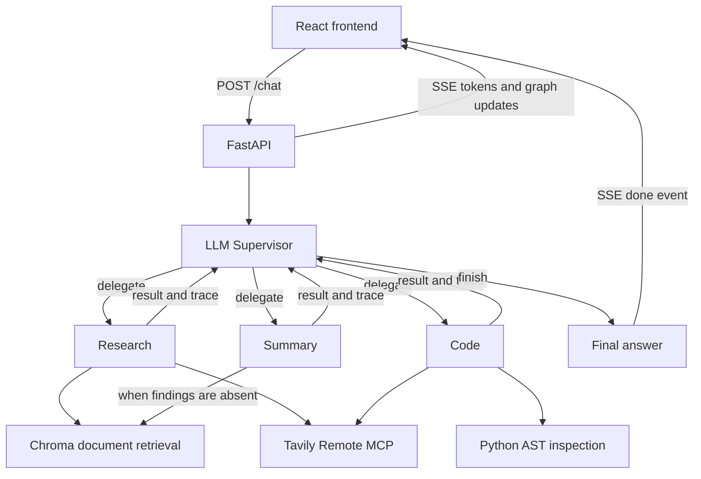

# Architecture

## Overview

The application uses a central LLM supervisor to choose the next specialist.
Workers run sequentially and return to the supervisor. The graph has no fixed
Research -> Code -> Summary sequence, and a request need not use every worker.

## Request execution

1. React sends the current question to `POST /chat`. Pydantic rejects empty,
   whitespace-only, or over-12,000-character queries.
2. FastAPI creates fresh graph state with the query and an eight-decision
   supervisor limit. Earlier browser turns are not included.
3. The supervisor receives the query and completed results and returns a
   structured decision: next agent, task instruction, reason, and optional
   retrieval settings or final answer.
4. The selected worker performs its task and returns a new result and trace
   entries. LangGraph merges those entries and returns to the supervisor.
5. The supervisor reviews results and either delegates again or finishes.
   Only successful worker evidence can support its final citations.
6. FastAPI sends worker text during generation, then traces, routing information,
   and citations from node updates. `done` carries the final answer; `error`
   reports an incomplete request.

The supervisor prompt describes the corpus as distributed systems research papers
and requests a document check before web research. The Research worker performs
that check; the supervisor has no direct retrieval tool. Explicit web-only requests
can bypass documents. This policy is prompted rather than code-enforced, and the
supervisor can choose `finish` without a worker. Code has its own model-selected
technical search tool, governed by its prompt and source restrictions.

## Agent responsibilities

| Component | Responsibility and tools |
| --- | --- |
| Supervisor | Reads state, delegates one task at a time, reviews results, writes the final answer; no direct search tool |
| Research | Retrieves documents, web evidence, or both, then generates grounded findings through LangChain LCEL |
| Code | Explains/generates code; can select Python AST inspection and shared Tavily search; does not execute supplied code |
| Summary | Condenses successful findings; retrieves documents if no successful findings exist; no web-search tool |

Research uses an LCEL chain for retrieval, prompt construction, wrapped async
generation, and string parsing. Summary invokes the model directly and parses
its response. Code uses a bounded model/tool loop: at most ten model turns and ten tool calls.
Worker failures become safe failure results for supervisor review; cancellation
propagates. The supervisor can reconsider failed work, but successful recovery
is not guaranteed. Endpoint errors produce a safe SSE error message.

## State and routing

`app/agents/state.py` defines the shared state:

- `user_query`: the original question.
- `current_task` and `next_agent`: the current delegation and next graph node.
- `results`: worker findings, success/error status, and structured evidence.
- `trace`: execution actions and provider/model/reason metadata.
- `iteration`, `max_iterations`, and `final_answer`: progress and termination.
- `allowed_domains`: optional web-source restrictions preserved across tasks.

`results` and `trace` have additive reducers, so workers return only new entries.
The supervisor sees successful results with evidence; failed results expose their
error without rejected findings or sources. TypedDict describes the state shape;
it does not validate runtime values. Supervisor decisions use Pydantic structured
output. At the iteration limit, the graph finishes with an incomplete-results
notice instead of asking another model to synthesize an answer.

## Models

`app/llm.py` constructs the configured model for each role. Example defaults in
`.env.example` are:

| Role | Provider / model | Intended rationale |
| --- | --- | --- |
| Supervisor | OpenAI / `gpt-5.1` | Structured decisions and final synthesis |
| Research | Google / `gemini-3.5-flash-lite` | Routine evidence-grounded generation |
| Code | OpenAI / `gpt-5.1` | Code analysis and tool selection |
| Summary | Google / `gemini-3.5-flash-lite` | Condensing supplied findings |

Assignments are fixed per role and configurable through environment variables;
there is no automatic provider failover or per-request price optimizer. These
are design intentions, not comparative quality/cost measurements. Routing events
show the actual provider/model metadata returned by completed nodes. A code-only
or direct-finish request may use just one provider.

## PDF ingestion and retrieval

`app/services/document_rag.py` handles the full local pipeline:

1. Read text from PDFs with pypdf, retaining original 1-based PDF page numbers.
2. Split each page independently into chunks of up to 800 characters, with
   configured overlap of 120 characters.
3. Assign IDs such as `raft.pdf:p5:c2`, preserving filename, page, and chunk.
4. Generate normalized CPU embeddings using `all-MiniLM-L6-v2` and write Chroma.
5. Retrieve the top-k similarity matches (default 10).
6. Add at most one continuation per original match: the next chunk on that page,
   or the first chunk on the immediately following PDF page. Deduplicate and
   retain ranked matches first. Expansion is not recursive; at most 2k chunks
   are returned.

Ingestion re-embeds the corpus, upserts current IDs, and removes stale IDs.
Embeddings are prepared before index writes, but the write phase is not atomic.
Stop requests before re-ingestion. The stored embedding model must match the
configured model. The verified local corpus contained 15 papers and 1,891 chunks;
PDFs and index files are not tracked by Git.

## MCP and citations

`app/services/tavily_mcp.py` uses the MCP SDK's Streamable HTTP client to initialize
a session, discover Tavily tools, and invoke search remotely. Research and Code
share this integration. It is actual MCP client/server communication, not a direct
Tavily REST replacement or direct agent-to-agent messaging.

Search results retain URL, title, text, and source identifiers. Requested hostname
restrictions are validated, passed to the remote tool when its schema supports
them, and always used to filter results. Once
established in graph state, restrictions cannot be broadened by later decisions.
The supervisor's interpretation of natural-language source restrictions still
relies on the LLM. SDK logs that could contain Tavily URL credentials are filtered.

`app/agents/citations.py` normalizes unambiguous grouped document IDs and checks
references against supplied document IDs and exact web URLs. Workers and final
synthesis validate citations; Research/Summary allow a bounded repair attempt.
Failed findings can remain inspectable as a failure with collected evidence, but
are excluded from the supervisor's final evidence. Valid citation identifiers do
not prove that each generated claim is supported.

## Frontend and SSE

`main.jsx` mounts `App.jsx` and imports CSS. Basic React state stores turns,
working output, traces, routing entries, citations, and final answers. The browser
uses `fetch` rather than `EventSource` because `/chat` is a POST request.
`stream.js` buffers incomplete SSE frames and decodes split UTF-8 characters.

Event types are `start`, `token`, `trace`, `routing`, `citation`, `done`, and
`error`. Supervisor control output is excluded from answer tokens. Worker text
is intermediate; only `done.final_answer` is the authoritative completed answer.
Trace and routing records arrive after their nodes return, not necessarily when
an operation begins. Output is rendered as escaped React text, with known citation
IDs linked to source excerpts. Duplicate source IDs are not linked ambiguously.
No Markdown rendering library is used.

## Runtime and storage

FastAPI loads the cached local embedding model during lifespan startup before
accepting requests. `/health` indicates HTTP readiness, not credential or index
validity. `/` serves `frontend/dist/index.html`, and `/assets` serves compiled
files. A missing build returns 503 with instructions; build before starting the
server so the asset route is registered.

Docker uses a Node build stage and a Python 3.13 runtime with CPU-only PyTorch.
One non-root Uvicorn worker serves both frontend and API. Compose supplies `.env`
at runtime, mounts the corpus read-only, and persists Chroma and model files in
separate named volumes. The host index is not shared with the container index.
See [Docker instructions](docker.md) for commands.

## Verification and boundaries

The five current offline tests cover API health/input validation, actual temporary
Chroma retrieval, citation validation, and real supervisor/graph routing with a
fake model and research worker. They do not validate every agent or live decisions.

Docker build, ingestion, local retrieval, homepage/assets, dependency consistency,
and healthy non-root startup were verified on 2026-10-28. The owner confirmed a
local document-first query worked. Historical Research-only RAGAS measurements
and their limits are in [evaluation.md](evaluation.md); they do not benchmark the
complete graph. No new paid checks were run during documentation cleanup.

The app has no verified AWS/public deployment, authentication, persistent chat
memory, arbitrary code execution sandbox, or production load benchmark. Keep the
application local until an appropriate deployment/security design is implemented.
