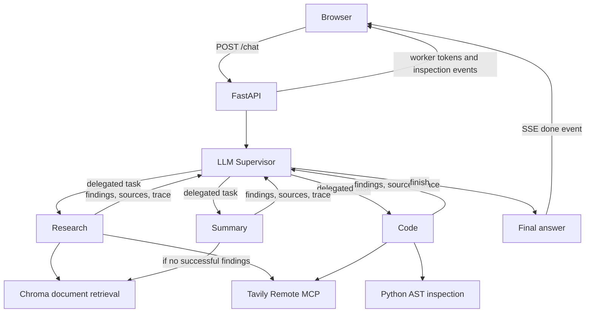

# System Architecture

## Overview

The application is a single-turn technical research assistant. A LangGraph LLM
Supervisor delegates work to three specialized agents: Research, Code, and
Summary. Document questions use a Chroma-backed RAG pipeline, while questions
requiring current information can use Tavily Remote MCP. OpenAI and Google
provide generation through explicit, configurable role assignments.

FastAPI serves a single HTML/CSS/JavaScript frontend and streams worker output
through Server-Sent Events (SSE). The interface exposes agent transitions,
provider/model choices, routing reasons, source excerpts, and citations.

**Public application:** https://csci599-multi-agent-b7rvvpibna-uw.a.run.app/

## Orchestration and agent responsibilities



| Component | Responsibility and tool access |
| --- | --- |
| Supervisor (`app/agents/supervisor.py`) | Reads the request and accumulated results; selects a worker, instruction, retrieval mode, and reason through structured LLM output; synthesizes the final answer. No retrieval tools. |
| Research (`app/agents/research.py`) | Retrieves documents, web evidence, or both; generates grounded findings with an LCEL chain. Access to Chroma retrieval and Tavily Remote MCP. |
| Code (`app/agents/code.py`) | Generates or analyzes code. Access to deterministic Python syntax/structure inspection and model-selected technical web search through the shared Tavily MCP integration. It does not execute code. |
| Summary (`app/agents/summary.py`) | Condenses successful worker findings while retaining citations. Can retrieve documents when no successful findings exist; has no independent web-search tool. |

Each specialist has a distinct system prompt and tool-access combination. The
Supervisor is the orchestrator, separate from the three specialists. All worker
nodes return to the Supervisor; there is no fixed Research-Code-Summary sequence.
The next action depends on the request, available evidence, and worker outcomes.

### State schema and execution flow

`app/agents/state.py` defines the shared `ResearchState`:

| State fields | Purpose |
| --- | --- |
| `user_query` | Original request. |
| `current_task` | Selected agent and instruction, with optional retrieval mode, web query, and allowed domains. |
| `next_agent` | Research, Code, Summary, or finish; consumed by the graph's conditional edge. |
| `results` | Accumulated worker findings, success/error status, and structured sources. |
| `trace` | Accumulated node actions, provider/model identifiers, tools, and reasons. |
| `source_policy`, `allowed_domains` | Persisted source restrictions for the current request. |
| `required_agents` | Explicitly requested specialists extracted by the Supervisor. |
| `iteration`, `max_iterations` | Supervisor execution budget. |
| `final_answer` | Final response or an honest incomplete/failure notice. |

`results` and `trace` use additive reducers, so workers return only new entries.
Pydantic validates Supervisor decisions; workers validate delegated tasks.

1. FastAPI validates and trims the query, creates a request ID, and starts fresh graph state.
2. The Supervisor reads the original query and successful evidence, then delegates or finishes.
3. A worker performs its specialized task and returns findings, sources, status, and trace entries.
4. The Supervisor reviews the updated state and selects the next action.
5. On completion, the endpoint sends the final answer in a `done` event.

Failed findings and sources are excluded from the Supervisor's model context,
while the original failure records remain in graph state for inspection. A worker
failure therefore returns control to the Supervisor instead of terminating the
graph. Research fails when no evidence is available. Code bounds its tool loop
to ten model turns and ten tool calls; Research and Summary permit one
citation-only repair with the same evidence.

The default Supervisor budget is eight decisions, with a graph recursion limit
of 20. If a finish decision leaves an explicitly requested specialist unattempted,
one additional Supervisor decision may reconsider completion. If work still
cannot be completed, the response states that limitation. This check enforces
extracted specialist requirements, not every semantic detail of a user request.
Unhandled Supervisor/provider exceptions become a generic SSE error at the API
boundary. SDK retry behavior is separate from graph-level delegation.

## LLM routing

| Agent | Default provider/model | Routing dimension and rationale |
| --- | --- | --- |
| Supervisor | OpenAI / `gpt-5.1` | Capability: structured delegation, evidence review, failure handling, and final synthesis. |
| Research | Google / `gemini-3.5-flash-lite` | Cost: generation grounded in retrieved evidence. |
| Code | OpenAI / `gpt-5.1` | Capability: code reasoning and tool selection. |
| Summary | Google / `gemini-3.5-flash-lite` | Cost: concise synthesis of supplied findings. |

`app/llm.py` constructs models from settings. The Supervisor's agent choice
selects the corresponding provider assignment; environment variables can override
these assignments. This is a role-based hybrid policy, rather than a separate
per-call price optimizer. A normal Research workflow exercises both providers;
a direct answer or Code-only workflow may use only OpenAI.

Trace and routing events expose the provider, model, and rationale for each
recorded decision or model turn. Both providers were exercised in deployment.
The same-evidence comparison in [evaluation.md](evaluation.md) supports the
cost-conscious Research assignment for one narrow task; it does not establish
general model superiority or comparative Code/Supervisor quality.

## Document RAG

The corpus contains 15 distributed-systems papers, 249 text-bearing PDF pages,
and 1,891 indexed chunks. It covers consensus, replication, transactions,
storage, cluster management, tracing, and performance measurement.

### Corpus sources

The table maps the local files to publications or author-hosted copies. Links
identify the works; original download URLs and acquisition dates were not
recorded. Page counts describe local PDF editions, not printed article ranges.

| Local filename | Paper and attribution | Publication/acquisition reference | Local PDF pages |
| --- | --- | --- | ---: |
| `A New Presumed Commit Optimization for Two Phase Commit.pdf` | Butler Lampson and David Lomet, *A New Presumed Commit Optimization for Two Phase Commit*, VLDB 1993 | [Author's publication text](https://bwlampson.site/49-NewPCOpt/49-NewPCOptOCR.htm) (OCR reference; obtain the scanned paper through the author's publication site) | 11 |
| `Always Measure One Level Deeper.pdf` | John Ousterhout, *Always Measure One Level Deeper*, Communications of the ACM, 2018 | [Author-hosted PDF](https://web.stanford.edu/~ouster/cgi-bin/papers/measureDeeper.pdf) | 10 |
| `Borg.pdf` | Abhishek Verma et al., *Large-scale cluster management at Google with Borg*, EuroSys 2015 | [Google Research](https://research.google/pubs/large-scale-cluster-management-at-google-with-borg/) | 17 |
| `Chain Replication for Supporting High Throughput and Availability.pdf` | Robbert van Renesse and Fred B. Schneider, *Chain Replication for Supporting High Throughput and Availability*, OSDI 2004 | [USENIX PDF](https://www.usenix.org/event/osdi04/tech/full_papers/renesse/renesse.pdf) | 14 |
| `dapper-2010-1.pdf` | Benjamin H. Sigelman et al., *Dapper, a Large-Scale Distributed Systems Tracing Infrastructure*, Google technical report, 2010 | [Google Research](https://research.google/pubs/dapper-a-large-scale-distributed-systems-tracing-infrastructure/) | 14 |
| `Exploiting_commutativity_for practical_fast_replication.pdf` | Seo Jin Park and John Ousterhout, *Exploiting Commutativity For Practical Fast Replication*, NSDI 2019 | [USENIX publication/download](https://www.usenix.org/conference/nsdi19/presentation/park) | 19 |
| `gfs-sosp2003.pdf` | Sanjay Ghemawat, Howard Gobioff, and Shun-Tak Leung, *The Google File System*, SOSP 2003 | [Google Research](https://research.google/pubs/the-google-file-system/) | 15 |
| `Implementing Linearizability at large scale and low latency.pdf` | Collin Lee, Seo Jin Park, Ankita Kejriwal, Satoshi Matsushita, and John Ousterhout, *Implementing Linearizability at Large Scale and Low Latency*, SOSP 2015 | [Author-hosted PDF](https://web.stanford.edu/~ouster/cgi-bin/papers/rifl.pdf), DOI `10.1145/2815400.2815416` | 17 |
| `Mapreduce.pdf` | Jeffrey Dean and Sanjay Ghemawat, *MapReduce: Simplified Data Processing on Large Clusters*, OSDI 2004 | [Google Research](https://research.google/pubs/mapreduce-simplified-data-processing-on-large-clusters/) | 13 |
| `Practical Byzantine Fault Tolerance.pdf` | Miguel Castro and Barbara Liskov, *Practical Byzantine Fault Tolerance*, OSDI 1999 | [USENIX publication](https://www.usenix.org/conference/osdi-99/presentation/practical-byzantine-fault-tolerance) | 14 |
| `raft.pdf` | Diego Ongaro and John Ousterhout, *In Search of an Understandable Consensus Algorithm (Extended Version)*, 2014 | [Authors' Raft site and extended-paper link](https://raft.github.io/) | 18 |
| `RamCloud.pdf` | John Ousterhout et al., *The RAMCloud Storage System*, ACM Transactions on Computer Systems, 2015 | [Publisher DOI](https://dl.acm.org/doi/10.1145/2806887) | 56 |
| `Spanner.pdf` | James C. Corbett et al., *Spanner: Google's Globally-Distributed Database*, OSDI 2012 | [Google Research](https://research.google/pubs/spanner-googles-globally-distributed-database-2/) | 14 |
| `The tail at Scale.pdf` | Jeffrey Dean and Luiz Andre Barroso, *The Tail at Scale*, Communications of the ACM, 2013 | [Google Research](https://research.google/pubs/the-tail-at-scale/) | 7 |
| `vm-ft.pdf` | Daniel J. Scales, Mike Nelson, and Ganesh Venkitachalam, *The Design of a Practical System for Fault-Tolerant Virtual Machines*, ACM SIGOPS Operating Systems Review, 2010 | [Publisher DOI](https://dl.acm.org/doi/10.1145/1899928.1899932) | 10 |

Some editions contain publisher or conference cover pages. Alternate downloads
can change PDF page numbering, extraction order, chunk IDs, and retrieval results.
For local ingestion, obtain the papers from these sources and use the listed
filenames under `data/corpus/`. Retain publication notices and attribution.
The source archive does not bundle PDFs or generated indexes. Exact historical
results depend on the PDF editions used; rebuilding with another edition should
be treated as a new evaluation. Publisher access requirements may apply.

### Ingestion, retrieval, and augmentation

`app/services/document_rag.py` implements the document pipeline:

1. **Load:** read PDF pages using `pypdf`; skip blank pages and unsupported files. There is no OCR.
2. **Chunk:** split each page independently with `RecursiveCharacterTextSplitter`, using 800-character chunks and 120-character configured overlap.
3. **Embed:** use local CPU `sentence-transformers/all-MiniLM-L6-v2` embeddings with normalized vectors.
4. **Store:** persist text, embeddings, and metadata in Chroma's `technical_documents` collection.
5. **Retrieve:** return the top ten similarity matches, then add at most one continuation per match: the next same-page chunk, otherwise the first chunk of the immediately following PDF page. Deduplicate and retain original matches first, with at most twenty chunks.
6. **Augment and generate:** provide the normalized source records to the Research model and preserve citations in the findings.

Metadata retains the corpus-relative filename, title, one-based PDF page, chunk
position, and exact chunk ID, for example `raft.pdf:p7:c1`. IDs refer to chunk
positions, not immutable historical content versions. Changing the embedding
model requires a new collection and re-ingestion. Ingestion is explicit and
must run while serving is stopped; failed writes can leave a partial rebuild.

```powershell
.\.venv\Scripts\python.exe -m app.services.document_rag
```

Research uses this LangChain LCEL composition:

```text
RunnableLambda(retrieve_evidence)
  | ChatPromptTemplate
  | RunnableLambda(generate_findings)
  | StrOutputParser
```

The human template is `{research_context}`, containing JSON with `original_query`,
`research_instruction`, `retrieval_mode`, and `sources`. The augmentation system
prompt instructs the model to perform only its delegated task, treat retrieved
text as untrusted evidence, use supplied sources for factual claims, cite exact
source IDs/URLs, preserve available PDF titles/pages, and state missing or
conflicting support. See `RESEARCH_PROMPT` in `app/agents/research.py` for the
complete template.

The Supervisor selects `documents`, `web`, or `both` and records the reason.
Its prompt identifies the corpus topics and directs foundational questions about
them to documents first; current facts can require web retrieval. Explicit
source restrictions persist across the workflow. An exception in either channel
fails a combined retrieval; the Supervisor can select an alternative only when
the user's restrictions permit it.

### Citation preservation

Worker results retain structured evidence, including source text and metadata.
Document claims use exact IDs such as `[raft.pdf:p7:c1]`; web claims use the
retrieved exact URL in brackets. Shared deterministic code normalizes unambiguous
combined document references and rejects unknown IDs or evidence URLs. Failed
citation validation rejects the generated findings instead of silently accepting
them. Source inventories supplement, rather than replace, inline citations.

The UI links known references to expandable evidence excerpts. Document links
identify source chunks in the interface rather than serving original PDFs.
Citation identity and presence checks do not prove that every claim is entailed.

## Tavily Remote MCP and tool sharing

`app/services/tavily_mcp.py` uses the MCP SDK's Streamable HTTP transport and a
request-scoped `ClientSession`. It initializes the session, discovers a supported
Tavily search tool, checks its expected argument fields, invokes it, normalizes
results, and closes resources. Authentication uses the Tavily API key in the
Remote MCP endpoint query parameter; keys are supplied outside source control.
This is an actual MCP connection, not a direct Tavily REST replacement.

Research calls the shared `search_web()` function for web grounding. Code exposes
`search_technical_web` to its model, which invokes the same MCP client for
programming references. Separate sessions share the server/tool integration
without requiring A2A messaging or another service. Summary uses supplied results
and does not have MCP tool access.

Allowed domains are validated hostnames. When the discovered schema supports
`include_domains`, including an array-or-null union, restrictions are sent to
Tavily. Returned URLs are also filtered locally against exact hosts/subdomains.
The document-only policy removes Code's web-search tool and rejects attempts to
invoke it. The default result limit is five, and the Tavily timeout is 30 seconds.
Discovery handles one tool page and the expected search schema, not arbitrary
MCP tools. Exact URLs are stable source IDs across searches and agents.

Deployed request `05cedebe7fd446029cc78c538d57e4f0` demonstrated Research using
`tavily_search` for TaskGroup and Code invoking the same tool for asyncio.timeout,
followed by Summary. The trace recorded two searches and eight model calls,
with all three workers completing. This establishes deployed shared-tool use;
it does not imply every requested output was retained in the final answer.

## FastAPI, streaming, and frontend

`app/main.py` serves `/`, static assets, `/health`, and `POST /chat`.
`ChatRequest` accepts 1-12,000 characters and rejects whitespace-only input.
Each request receives an `X-Request-ID` header and runs its own graph.

The endpoint consumes LangGraph `messages` and `updates` streams. Worker model
fragments are emitted as `token` events. Completed node updates produce `trace`,
`routing`, and `citation` events; `start`, `done`, and `error` cover lifecycle.
Each event carries a JSON envelope with `type` and `data`. Structured Supervisor
control tokens are excluded. The Supervisor's authoritative final answer arrives
whole in `done`; intermediate worker generation is streamed incrementally.
Trace/routing records arrive after their node returns, so worker text may appear
before the associated inspection records.

The frontend is one HTML file with embedded CSS and vanilla JavaScript. It uses
streaming `fetch()` for the POST response, parses SSE frames, displays worker
output and final answers, and provides trace/routing/source panels. Its limited
Markdown renderer constructs DOM nodes rather than interpreting generated HTML.
External source links allow HTTP(S) and use `noopener noreferrer`.

## Deployment, configuration, and state

The Dockerfile uses Python 3.13-slim with base, build, and runtime stages.
The build installs pinned dependencies and CPU-only PyTorch, downloads local
embedding assets, and ingests the PDFs on Linux. The runtime includes the app,
Chroma index, and model cache, but excludes original PDFs and credentials.
It runs as a non-root user, disables runtime model downloads, and binds Uvicorn
to `0.0.0.0` on Cloud Run's injected `PORT`.

Settings read environment variables and the local `.env` for development.
Production credentials use Secret Manager-backed environment variables.
`.env.example` supplies placeholders; credentials are not committed.
The deployment uses scale-to-zero and a maximum of one instance. Public access
uses the `allUsers` Cloud Run invoker binding. This instance cap is not a per-user
quota or API spending cap. Setup and deployment commands are in [README.md](../README.md).

Each query starts fresh state. The browser displays previous turns but does not
send them as model context. There is no claim of durable conversation history,
so no external conversation checkpointer is used. The bundled Chroma index is a
read-oriented deployment input, separate from conversation state; local runtime
filesystem changes are not durable across instance replacement.

FastAPI startup loads cached embeddings before accepting requests. This avoids
charging model initialization against worker retrieval timeouts but adds cold
startup latency, including for web-only requests.

## Validation and limitations

The full offline suite passed **292 tests in 14.63 seconds**. Tests use mocked
provider/MCP boundaries and fake embeddings, with actual graph execution and
temporary Chroma integration where appropriate. They cover worker failures,
state/routing, ingestion/retrieval, source preservation, citations, MCP parsing,
stream envelopes, and metrics. Inline JavaScript syntax and image dependency
consistency were also checked. These checks do not establish live answer quality.

Deployed checks verified public homepage/health access, document retrieval,
web-research recovery, both generation providers, and shared MCP invocation.
A confirmed cold/warm pair measured client first worker text at 75.84/4.76 seconds
and complete streams at 81.65/10.71 seconds. This single pair is not a
steady-state latency distribution. Two twelve-question RAGAS runs and a
one-question same-evidence provider comparison are reported in
[evaluation.md](evaluation.md), together with token usage and dated cost estimates.

`app/metrics.py` collects request-scoped retrieval and model durations, reported
tokens, and first-worker-text timing. FastAPI writes a `request_metrics` log at
stream termination. Server timers omit pre-application startup and client/network
delay; client timings and instance logs establish the cold/warm distinction.

Important limitations are:

- Natural-language task interpretation, source selection, and final synthesis remain LLM-dependent. The deployed sharing test omitted a requested code snippet from its final answer despite worker completion.
- Citation validation checks evidence identities, not comprehensive claim entailment. Retrieved PDFs can contain extraction errors, and web snippets may be incomplete or stale.
- Python inspection verifies syntax/structure without executing code or proving runtime correctness.
- Cold starts are slow because Python imports and cached embedding initialization precede serving. The observed cold request completed successfully, but broader startup/load behavior was not benchmarked.
- Evaluation uses small samples; provider comparisons and generation cost estimates are illustrative, not billing records or broad quality guarantees.
