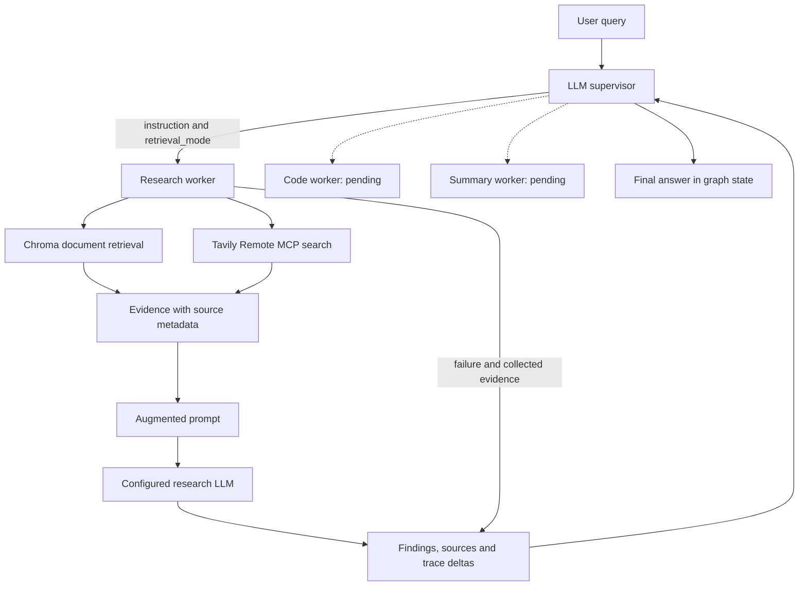

# Architecture and implementation status

Updated: 2026-10-26. Assignment basis: `Assignment_2_Description.pdf`, especially sections 2.1-2.5, 3.1, 3.3-3.5, and rubric 7.2. This document describes current source code and verification. `architecture_review.md` and `implementation_notes.md` describe earlier development stages.

## Current scope

Implemented: supervisor decisions, Research document/web source selection, corpus ingestion, Chroma retrieval, LCEL evidence augmentation and generation, Tavily Remote MCP, provider configuration, and offline tests. FastAPI currently serves a frontend shell and health endpoint.

The RAG plumbing is implemented and tested with fixtures. A substantial production corpus, real-model retrieval evaluation, Code and Summary workers, complete graph execution, chat/SSE integration, dynamic provider routing, exercised MCP sharing, and Cloud Run deployment remain incomplete.

## Components and orchestration

| File | Responsibility | Status |
| --- | --- | --- |
| `app/agents/supervisor.py` | Select a worker, instruction, research retrieval mode, and rationale using structured LLM output. | Implemented; source-selection mapping checked with mocks during development. |
| `app/agents/research.py` | Retrieve evidence, augment a prompt, generate findings, and return sources and traces. | Implemented; persistent offline tests. |
| `app/services/document_rag.py` | Load/chunk documents, synchronize a local Chroma collection, and retrieve chunks. | Implemented; real Chroma tested with fake embeddings. |
| `app/services/tavily_mcp.py` | Discover and invoke Tavily search through Remote MCP; normalize web evidence. | Implemented; live compatibility unverified. |
| `app/llm.py` | Construct the configured OpenAI or Google chat model for each role. | Implemented; live model compatibility unverified. |
| `app/agents/state.py` | Define task, result, trace, and graph-state contracts and reducers. | Implemented. |
| `app/agents/agents.py` | Define supervisor-to-worker routing and worker-to-supervisor edges. | Incomplete: imports missing `code.py` and `summary.py`. |
| `app/main.py` | Serve static frontend assets and `/health`. | Implemented; no chat/SSE endpoint yet. |

The intended connected flow is below. Research paths execute in isolation and in a small test graph; this diagram does not imply the incomplete production graph runs end to end.



The intended orchestration pattern is a central supervisor. Code and Summary are planned specialists; the supervisor does not count toward the three-specialist requirement. Research currently has document retrieval and Tavily access; distinct tools/prompts for the other specialists remain to be implemented.

### Shared state

| Contract | Fields and behavior |
| --- | --- |
| `AgentTask` | Required `agent` and `instruction`; optional `retrieval_mode` (`documents`, `web`, `both`). |
| `AgentResult` | `agent`, `instruction`, `content`, `success`, `error`; optional structured `sources`. |
| `TraceEvent` | Node, action, detail, provider, model, rationale; optional tool name. |
| `ResearchState` | Original query, messages, tasks/current task, next agent, results, final answer, iteration limits, and trace. |

`results` and `trace` use additive reducers. Workers return only new entries, so LangGraph appends them without duplicating history. `messages` uses LangGraph's `add_messages` reducer. TypedDict contracts describe dictionary shapes; they do not enforce runtime validation. The supervisor's Pydantic decision validates its structured retrieval mode, and Research also checks the mode at runtime.

## Research source selection

The supervisor prompt asks the LLM to choose evidence sources and explain its choice in `reason`. The selected mode is included in `current_task` and in the supervisor trace detail. Research also traces each retrieval tool.

| Mode | Research behavior | Example intent |
| --- | --- | --- |
| `documents` | Chroma only; also the default when the task omits a mode. | Answer from the provided corpus. |
| `web` | Tavily MCP only. | Search for current external information. |
| `both` | Retrieve documents, then search Tavily. | Compare corpus material with current information. |

The supervisor prompt defaults ambiguous requests to documents and instructs it to respect explicit source restrictions. Research enforces the delegated mode; it does not independently interpret the original query's source restrictions. Actual LLM selection quality has not been verified live.

A failed channel returns worker failure without an automatic fallback. In `both` mode, a document failure stops before web retrieval; a later web failure preserves collected document evidence. An empty result list is different from an exception: if one channel returns an empty list and the other supplies evidence, generation can proceed. Missing or empty Chroma indexes raise errors rather than returning empty results. With no evidence at all, Research skips model creation and generation.

## Document ingestion and retrieval

A substantial technical-document corpus is still required. The current repository has test fixtures, not a submission-ready corpus. LangGraph/LangChain documentation was proposed as a corpus; source selection, acquisition, and a reproducible source manifest remain pending. Small fixtures verify behavior but do not satisfy the assignment's corpus requirement.

`app/services/document_rag.py` uses the existing configuration:

| Setting | Default |
| --- | --- |
| `CORPUS_DIR` | `./data/corpus` |
| `CHROMA_PERSIST_DIR` | `./data/chroma_index` |
| `CHROMA_COLLECTION` | `technical_documents` |
| `EMBEDDING_MODEL` | `sentence-transformers/all-MiniLM-L6-v2` |
| `RETRIEVAL_TOP_K` | `5` |

Relative configured directories resolve against the project root.

1. `load_chunks()` recursively reads nonempty UTF-8 `.md` and `.txt` files, including UTF-8 BOM input. Other extensions are ignored; PDF loading is not implemented. The first Markdown H1 supplies the title, otherwise the filename stem is used.
2. `RecursiveCharacterTextSplitter` uses 800-character chunks, configured overlap of 120 characters, and start offsets. These are initial settings, not evaluated optima or token limits.
3. Metadata preserves the corpus-relative path, title, source kind, document ID, chunk ID, and start offset. Document IDs hash the relative path; chunk IDs hash path, title, offset, and content. Unchanged chunks retain IDs; edits or title changes can create new IDs.
4. `get_embeddings()` lazily loads the configured Hugging Face model on CPU and caches one model instance. Vectors are normalized. The initial model use may download weights; local embedding uses no paid embedding API. PyTorch and Transformers increase dependency size and cold-start work.
5. `ingest_documents()` adds new chunks in batches of 64, skips existing IDs without re-embedding, then deletes obsolete IDs in batches. The configured collection is dedicated to this corpus. Empty/unreadable input is rejected before index synchronization. Failed writes propagate; rerunning ingestion can finish an interrupted synchronization.
6. `get_vector_store()` checks the collection's embedding-model name against configuration. A changed model name requires a new collection name. Retrieval never creates a missing collection or automatically ingests documents.
7. `retrieve_documents()` uses a LangChain Chroma retriever for top-k vector similarity and returns `Document` objects with their metadata. There is no relevance cutoff or reranking; similarity alone does not prove a chunk answers the question.

Run ingestion explicitly after preparing the corpus:

```powershell
.\.venv\Scripts\python.exe -m app.services.document_rag
```

Ingestion is a repeatable synchronization, not an atomic index swap. Run it while requests are stopped. Failed multi-batch ingestion can leave some new chunks alongside old chunks until a successful rerun. Preparing a deployment index and packaging model assets remain deployment work; request handlers should not rebuild the corpus.

## LCEL augmentation and generation

The Research chain is:

```python
RunnableLambda(retrieve_evidence) | prompt | RunnableLambda(generate_findings) | StrOutputParser()
```

`chain.ainvoke()` supplies the original query, research instruction, and retrieval mode. `retrieve_evidence()` calls the selected services and returns a dictionary whose `research_context` value is JSON containing that request and the normalized sources. The human prompt template `{research_context}` is filled from that dictionary key. The system prompt instructs the model to treat source text as untrusted evidence, cite supplied sources, distinguish interpretation and uncertainty, and acknowledge missing support.

`generate_findings()` invokes the shared research-model factory only after evidence exists. `StrOutputParser` extracts text from the model response, including supported text-block responses. Blank output becomes failure. A source appendix is added after generation.

### Evidence and citation contract

All evidence entries contain `source_id`, `source_kind`, `title`, `content`, and `metadata`.

- Document entries use the original chunk ID as `source_id`, include the relative document path as `source`, and retain document/chunk IDs and offsets in metadata. The prompt requests inline `[source_id]` citations.
- Web entries retain the Tavily URL as `url` and receive `source_kind="web"`. The prompt requests exact inline URLs. Web IDs such as `web-1` are local to each search, not globally unique across tasks.
- The structured `AgentResult.sources` preserves snippets. The text appendix lists IDs, titles, and paths/URLs. It does not duplicate snippets within the textual report; the supervisor currently serializes full results, including structured evidence, into its context.

Source preservation does not validate claim entailment or ensure every generated reference is correct. Document paths are identifiers, not yet clickable document-serving endpoints. Final citation preservation through the pending Summary worker, supervisor output, and frontend still needs verification.

### Async behavior and failures

Research is async and must run through graph `ainvoke`/`astream`. Synchronous Chroma retrieval runs via `asyncio.to_thread()` so it does not directly block the event loop. Cancellation or timeout stops awaiting that thread but cannot forcibly stop its underlying computation.

The combined retrieval stage has `RESEARCH_TIMEOUT_SECONDS` (default 60 seconds); synthesis has a separate timeout of the same duration. Tavily also has its own `TAVILY_TIMEOUT_SECONDS` (default 30 seconds). These are stage limits, not a whole-workflow deadline. The provider factory currently retains `max_retries=2` and a 30-second provider timeout.

Invalid tasks, invalid modes, retrieval failures, missing evidence, blank generation, and model errors return `success=False` with safe error text. Collected sources survive subsequent failures. Cancellation propagates to the caller. Tests cover these worker behaviors; full supervisor recovery and production graph failure isolation remain unverified.

## Tavily Remote MCP

`search_web()` opens a request-scoped Streamable HTTP transport, initializes `ClientSession`, lists tools, invokes search, normalizes results, and closes the session/transport. Authentication uses the assignment endpoint pattern `https://mcp.tavily.com/mcp/?tavilyApiKey=<encoded-key>`; credentials remain in the environment or ignored `.env`.

The current implementation lists one page of tools, selects the first `tavily_search` or `tavily-search` with a string `query` property, adds supported `search_depth`/`max_results` arguments, and checks required argument names. It does not implement discovery pagination, arbitrary capability selection, or full JSON-schema validation.

Structured content or JSON-text results are normalized to usable HTTP(S) URLs with snippets. Exact URLs are deduplicated; result count is capped by configuration, titles at 500 characters, and snippets at 6,000 characters. Optional score, publication date, and author metadata are retained. Malformed results fail safely.

Filters on `httpx2` and `mcp.client.streamable_http` suppress records containing the Tavily endpoint or query-key marker, including exception text. This is not universal credential redaction for arbitrary logs or tracing. There are no application-level search retries or pooled sessions. Only Research currently invokes Tavily; sharing the service function does not satisfy the rubric's requirement that multiple agents actually invoke the same MCP tool.

## LLM routing and application boundary

| Role | Configured provider/model defaults | Current status |
| --- | --- | --- |
| Supervisor | OpenAI / `gpt-5.1` | Decision node implemented. |
| Research | Google / `gemini-2.5-flash` | Worker implemented. |
| Code | OpenAI / `gpt-5.1` | Configuration only; worker missing. |
| Summary | Google / `gemini-2.5-flash` | Configuration only; worker missing. |

These are static role assignments, not completed cost/capability routing. Research traces explicitly mark dynamic model routing as pending. Source selection and generation-provider routing are separate decisions. Model IDs are configured values; this work did not verify availability through live API calls.

`Settings` reads the root `.env` and environment overrides. `validate_runtime()` exists but is not called by startup. FastAPI does not yet invoke the graph, stream tokens, or expose document citations. The design intends single-turn requests; durable conversation memory is not currently claimed. A Chroma index is separate from conversation persistence, and its Cloud Run packaging remains unverified.

## Verification

Current persistent offline suite: **41 passed** on 2026-10-26:

| File | Cases | What is exercised |
| --- | --- | --- |
| `tests/test_health.py` | 4 | Health endpoint, homepage, static CSS, and missing route. |
| `tests/test_document_rag.py` | 14 | Real temporary Chroma with deterministic fake embeddings: chunks/provenance, retrieval, repeat ingestion, edits/deletions, failures, model mismatch, Unicode, batching, and titles. |
| `tests/test_research.py` | 23 | Real LCEL with mocked retrieval/model calls: modes, augmentation, citations, validation, empty evidence, failures, text formats, timeout, cancellation, and a small real LangGraph's additive reducers. |

Additional one-off development checks exercised supervisor mode mapping with mocked structured decisions and a real temporary Chroma-to-Research-to-LangGraph path with fake embeddings and generation. Those checks are not persistent tests. The current suite does not contain the older `test_research_mcp.py` referenced in prior notes; historical 42-test/MCP coverage claims are not evidence for this checkout.

Run offline checks from the repository root:

```powershell
.\.venv\Scripts\python.exe -m pytest -q -p no:cacheprovider
.\.venv\Scripts\python.exe -m pytest tests/test_document_rag.py tests/test_research.py -q -p no:cacheprovider
.\.venv\Scripts\python.exe -m pip check
```

Pytest excludes the `live` marker by default. No live test is currently shipped. Paid/quota-limited tests require separate explicit approval; implementing a feature does not authorize API spending. This development used no paid APIs or model-weight downloads. Real embeddings/retrieval quality, Tavily authentication and remote schema compatibility, generation-model behavior, supervisor source-choice quality, full production execution, and Cloud Run behavior remain unverified.

## Remaining work

- **P0 - Corpus and evaluation:** Acquire a substantial, attributable technical corpus with reproducible source metadata, build its index with real embeddings, and evaluate chunking/retrieval. Report fixed-question-set RAGAS faithfulness, answer relevance, context precision, and context recall in `docs/evaluation.md`.
- **P0 - Specialists and orchestration:** Implement distinct Code and Summary workers with appropriate tools/prompts; exercise the full async graph and preserve citations through the final answer.
- **P0 - Provider routing and MCP sharing:** Implement inspectable cost/capability routing across providers, and have a second agent invoke the same MCP tool in a useful distinct context.
- **P0 - Delivery:** Connect chat/SSE and citation/trace UI, prepare a Linux-compatible container and Chroma/model assets, deploy to Cloud Run, and complete README, evaluation, and process-log deliverables.
- **P1 - Persistent integration coverage:** Add supervisor source-selection and full-graph recovery tests as those components become operational. Restore focused MCP transport/schema/response tests for the current service and separately budget any live compatibility check.
- **P1 - Grounding and reliability:** Validate source references, bound workflow/context costs, measure cold/warm latency, and review provider retries. Citation-reference checks alone cannot establish factual entailment.
