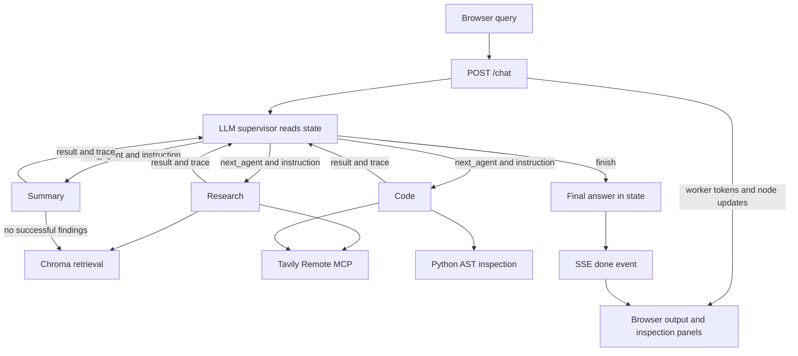

# Architecture and implementation status

Updated: 2026-10-27. Requirements: `Assignment_2_Description.pdf`, especially sections 2, 3, 5, 6, and rubric 7.2, interpreted alongside the TA clarification supplied by the project owner.

## Current scope

Implemented: three specialized workers, an asynchronous LLM supervisor, LangGraph construction, document ingestion/retrieval, Research LCEL generation, Tavily Remote MCP access, fixed provider assignments, and offline tests. FastAPI serves a single-page frontend, `/health`, and `POST /chat` with SSE. Vanilla JavaScript connects the form to streamed worker text, final answers, routing, traces, and citations. Mocked Chrome smoke tests passed at desktop and narrow widths; live end-to-end provider execution and deployment remain unverified. Research-only live RAGAS runs are recorded in [evaluation.md](evaluation.md); they do not verify the full application.

## Components and orchestration

| File | Responsibility |
| --- | --- |
| `app/agents/supervisor.py` | Read state, select the next worker or finish through structured LLM output, and record a delegation reason. |
| `app/agents/research.py` | Retrieve document/web evidence and generate grounded findings through LCEL. |
| `app/agents/code.py` | Analyze/generate code with model-selected Python inspection and technical web search. |
| `app/agents/summary.py` | Condense successful findings; retrieve documents when no successful findings exist. |
| `app/agents/agents.py` | Compile the graph and route every completed worker back to the supervisor. |
| `app/agents/state.py` | Define tasks, results, traces, and state reducers. |
| `app/llm.py` | Construct the configured OpenAI or Google model for each role. |
| `app/services/document_rag.py` | Load/chunk PDFs, embed/index them in Chroma, and retrieve evidence. |
| `app/services/tavily_mcp.py` | Discover/invoke Tavily search through Remote MCP and normalize evidence. |
| `app/main.py` | Serve static assets and `/health`; run the graph through `POST /chat` and translate generation/state updates into SSE. |
| `app/schemas.py` | Validate chat input and define routing, citation, trace, and stream envelopes. |
| `app/static/app.js` | Send queries, incrementally parse SSE, and render responses plus per-turn inspection panels. |
| `app/static/style.css` | Provide responsive layout, response whitespace preservation, and readable citation links with keyboard-focus styling. |



This is a central supervisor pattern. Each worker has a distinct prompt and tool-access combination. Research selects document/web channels from its delegated retrieval mode. Code can inspect Python syntax/structure without executing supplied code and can request technical web references. Summary uses supplied findings or document retrieval and has no web-search tool. The supervisor does not count toward the three-specialist requirement. The diagram describes implemented graph wiring, not verified deployed execution.

### State and routing decisions

| Contract | Fields and behavior |
| --- | --- |
| `AgentTask` | `agent`, `instruction`, optional `retrieval_mode` (`documents`, `web`, `both`). |
| `AgentResult` | `agent`, `instruction`, `content`, `success`, `error`, optional structured `sources`. |
| `TraceEvent` | `node`, `action`, `detail`, `provider`, `model`, `reason`, optional `tool`. |
| `ResearchState` | `user_query`, `current_task`, `next_agent`, `results`, `final_answer`, `iteration`, `max_iterations`, `trace`. |

The supervisor context reads `user_query`, `results` (including worker success/error and evidence), `iteration`, and `max_iterations`. The LLM selects `next_agent`, an instruction, a reason, a research retrieval mode when applicable, and a final answer when finished. It delegates one `current_task` at a time, then reviews the worker result before deciding again; there is no queued task plan. The unused `tasks` state field and `pending_tasks` context entry were removed. The conditional edge reads `next_agent` to dispatch to a worker or end execution.

After every worker, the supervisor LLM reviews accumulated results and chooses again. There is no fixed Research -> Code -> Summary sequence. Its prompt asks it to consider alternatives after failures and avoid unnecessary delegation. At the iteration limit, code ends the workflow with an incomplete-results notice. This limit does not synthesize a partial answer. The TA clarification allows state-based dispatch after an LLM-generated plan without consulting the LLM after every worker; our approach retains an LLM decision after every worker, trading additional calls and latency for reconsideration based on returned evidence.

`results` and `trace` use additive reducers; workers return only new entries. The unused shared `messages` field was removed; workers construct their model messages locally. LangGraph message streaming uses model callbacks and does not require a shared conversation-history field. TypedDict shapes do not enforce runtime validation; supervisor decisions use Pydantic structured output and workers validate their delegated tasks.

### Failure handling

All three workers catch ordinary exceptions, return `success=False` with safe error text, and preserve collected evidence. Research fails on missing evidence instead of generating unsupported findings. Code reports tool errors back to its model and bounds execution to ten model turns/ten tool calls. Summary rejects blank responses and, when evidence exists, output containing none of the supplied citation identifiers/URLs. This presence check does not validate every claim or citation. Worker cancellation propagates to the caller.

Worker failure results return along the normal edge to the supervisor, where they are visible in `results`. Persistent full-graph tests now verify that a model failure in each worker reaches the next supervisor decision and ends with an honest failure response. These tests use real nodes and graph routing with mocked model/retrieval boundaries; they do not prove live decision quality or successful completion through an alternative worker. The supervisor's own model/configuration exceptions are not caught; worker failure isolation does not imply that provider failures at the supervisor are handled.

## Fixed provider routing

| Role | Default provider/model | Dimension and design rationale |
| --- | --- | --- |
| Supervisor | OpenAI / `gpt-5.1` | Capability-based: structured delegation, interpretation of returned evidence/failures, and final grounded synthesis. The supervisor also writes final answers, so its responsibility extends beyond classification. |
| Research | Google / `gemini-3.5-flash-lite` | Cost-based: routine generation over retrieved evidence; keep repeated research calls economical while grounding them in supplied sources. |
| Code | OpenAI / `gpt-5.1` | Capability-based: code reasoning and tool-assisted analysis, including choosing inspection/search tools. |
| Summary | Google / `gemini-3.5-flash-lite` | Cost-based: concise condensation of supplied findings/evidence without independent web research. |

The overall policy is hybrid: capability-oriented orchestration/code work and cost-oriented evidence processing/summarization. These are design rationales, not measured proof that one provider is cheaper or more accurate for this workload. Exact pricing and comparative latency/quality remain evaluation work. Settings/environment overrides can change assignments; changing them requires keeping rationale and verification consistent.

Per the TA clarification and assignment section 6, fixed providers per agent are acceptable. Provider routing occurs through the supervisor's choice of agent; dynamic provider selection for every call is optional. A normal Supervisor -> Research -> Supervisor or Supervisor -> Summary -> Supervisor path calls both OpenAI and Google when generation succeeds. A direct finish, a code-only path, or a worker failure before generation may use only OpenAI. Both providers must demonstrably participate in normal deployed use; merely configuring them or using OpenAI as an offline evaluator is insufficient.

Current trace events carry provider/model and a reason. Worker `llm_started` reasons explain the role's cost-based or capability-based assignment, including each repeated Code model turn. Supervisor decision events include its capability-based provider rationale alongside the LLM's original delegation/source-selection or finish reason. The iteration-limit event has no provider/model because no generation occurs on that branch. The endpoint emits these call records as `routing` events, and the frontend displays them by turn. They arrive after the node returns its trace, rather than at call start. Offline tests check supervisor rationale, graph call records, and endpoint routing payloads; live execution must still demonstrate both providers in normal use. Dynamic per-call provider routing is optional.

## Document RAG

The selected corpus contains 15 distributed systems PDFs (including Raft, GFS, Spanner, Borg, MapReduce, and PBFT): 249 text-bearing pages and 1,891 chunks. Local indexing and two live Research evaluations are recorded in [evaluation.md](evaluation.md). The ignored `data/` directory is not bundled in Git; corpus attribution/acquisition and reproducible submission packaging remain required.

`load_chunks()` recursively reads PDFs with `pypdf`, ignores symlinks/other extensions and blank pages, and splits each page independently into up to 800 characters with configured overlap 120. Corrupt PDFs, PDFs requiring a nonempty password, and textless PDFs fail ingestion; there is no OCR. Metadata preserves corpus-relative `source`, title, 1-based PDF file page, `source_kind`, document/chunk IDs, and page-relative start offset. Example citation ID: `raft.pdf:p7:c1`. IDs identify positions, not historical content versions.

Local `sentence-transformers/all-MiniLM-L6-v2` embeddings run on CPU with normalized vectors and a cached model instance. Initial use may download weights. `ingest_documents()` manually re-embeds all chunks in batches of 64, prepares vectors before writes, upserts current IDs, then removes stale IDs. Failed writes can leave a partial rebuild; run ingestion while requests are stopped. A changed embedding-model name requires a new collection name. Retrieval rejects missing/empty indexes rather than ingesting during requests.

Defaults: `CORPUS_DIR=./data/corpus`, `CHROMA_PERSIST_DIR=./data/chroma_index`, `CHROMA_COLLECTION=technical_documents`, `RETRIEVAL_TOP_K=10`. Relative paths resolve against the project root. Retrieval uses a LangChain Chroma retriever, keeps ranked matches first, and adds at most one continuation per match: the next same-page chunk, otherwise the first chunk of the immediately following PDF page in the same paper. Results are deduplicated, preserve metadata, and contain at most 20 chunks at the default k. There is no relevance cutoff or reranking. The continuation strategy and measured trade-offs are documented in the evaluation report.

Research source modes are `documents` (default), `web`, and `both`. The supervisor selects the mode and explains it; Research enforces it. In `both`, document retrieval precedes web retrieval. A channel exception fails the worker without automatic fallback, preserving previously collected sources. An empty channel can be combined with evidence from the other channel; no evidence skips generation.

The Research LCEL chain is `RunnableLambda(retrieve_evidence) | prompt | RunnableLambda(generate_findings) | StrOutputParser()`. Retrieval returns `research_context`: JSON containing the original query, delegated instruction, mode, and normalized sources. The human template is `{research_context}`. The system prompt treats sources as untrusted data, restricts factual claims to supplied evidence, requests exact citation IDs/URLs and available titles/PDF pages, and requires acknowledgment of missing support. Model construction occurs only after evidence exists.

Sources preserve text and metadata in `AgentResult.sources`. Research and Summary append source inventories; Summary also preserves sources from successful findings. Source preservation and citation presence do not establish entailment. The successful offline graph test verifies retained evidence and a citation through Research, Code, Summary, and final state using mocked model responses. A supervisor unit test also verifies that a supplied final answer/citation is returned unchanged. These checks do not prove that live models preserve citations; document identifiers are not yet document-serving URLs.

Research retrieval and generation each have `RESEARCH_TIMEOUT_SECONDS` (default 60). Code and Summary each use that setting for their worker operation. Chroma calls use `asyncio.to_thread`; cancellation cannot forcibly stop underlying thread computation. The provider factory sets a 30-second timeout and two retries. These are not a whole-workflow deadline.

## Tavily Remote MCP sharing

`search_web()` uses a request-scoped Streamable HTTP transport and `ClientSession`: initialize, list tools, select a supported Tavily search tool, invoke it, normalize results, and close resources. Authentication uses `https://mcp.tavily.com/mcp/?tavilyApiKey=<encoded-key>` with credentials outside source control. Tavily timeout defaults to 30 seconds. Discovery handles one tool page and checks expected argument names/types, not arbitrary schemas or discovery pagination.

Evidence retains HTTP(S) URLs, snippets, titles, and optional metadata; exact URLs are deduplicated. Result count defaults to five, titles are capped at 500 characters and snippets at 6,000. Selected transport log filters suppress Tavily endpoint/key-marker records; this is not universal credential redaction.

Research invokes this service for web grounding; Code exposes it as `search_technical_web` for model-requested programming references. This provides the same Remote MCP search capability in two distinct contexts without duplicating transport code. Shared access and mocked invocation do not prove deployed sharing: both agents must actually invoke the same MCP tool in suitable live/deployed examples. Summary has no MCP access. Code's web restrictions are prompt instructions, not a deterministic permission gate.

## Application and deployment boundary

`Settings` reads root `.env` plus environment overrides. `validate_runtime()` exists but startup does not call it. Each chat request starts fresh graph state; the application claims no durable conversation memory. The browser retains visible turns for the current page, but does not send earlier turns as model context. Chroma index persistence is separate from conversation state. Cloud Run packaging, Linux dependencies, model/index assets, cold starts, and deployment remain unverified.

### Chat/SSE execution

`ChatRequest` accepts a string of 1-12,000 characters, trims surrounding whitespace, and rejects whitespace-only input. Invalid requests return HTTP 422 before graph construction. `POST /chat` compiles a graph per request and runs `graph.astream()` with `stream_mode=["messages", "updates"]`, an eight-decision iteration budget, and a recursion limit of 20. The supervisor awaits structured model generation with `ainvoke()`; workers already use asynchronous generation.

- `messages` supplies model fragments through LangGraph callbacks during generation. The endpoint forwards worker `AIMessageChunk` text as `token` events. It excludes Supervisor structured control output, tool argument chunks, non-text blocks, and completed non-chunk messages. Supported models can stream through these callbacks even when the worker awaits `ainvoke()`; live provider behavior still needs verification.
- `updates` supplies the deltas returned by every completed node. Workers return only new result/trace entries, so additive state reducers do not cause history to be replayed. The endpoint translates these deltas into `trace`, `routing`, and `citation` events. Worker text can arrive before the corresponding stored trace/routing explanation. Research retrieval itself produces no model text.
- A `start` event identifies the normalized query. After graph execution finishes, `done` supplies the authoritative Supervisor `final_answer`. This final structured answer is delivered whole, while intermediate worker generation is streamed. The implementation does not claim incremental streaming of the Supervisor's final answer.

Every SSE message carries a `StreamEvent` JSON envelope with `type` and `data`; the SSE event name matches `type`. Dedicated models shape trace/routing/citation payloads, while the envelope's `data` dictionary is not a validated union. `EventSourceResponse` provides framing, keepalive comments, and disconnect handling. The stream disables caching. Unexpected graph errors produce a safe `error` event rather than exposing exception text; missing/empty final answers also produce `error`. A stream already started retains HTTP 200, so clients must inspect terminal events. Cancellation propagates; in-flight retrieval threads cannot be forcibly stopped.

Citation events preserve source ID, corpus path or web URL, available chunk ID/PDF page, and excerpt. Deduplication is scoped to one request and keyed by location plus source ID, so distinct web URLs sharing a search-local ID remain separate. Evidence may come from failed workers and should not be interpreted as independently verified support for the final answer.

### Frontend rendering

`app.js` uses POST `fetch()` and a streaming reader. `TextDecoder` handles split UTF-8 characters; a buffer waits for complete LF/CRLF SSE frames, combines data lines, and ignores keepalive comments. An interrupted stream without `done`/`error`, malformed JSON, an HTTP error, or an unexpected content type is shown as a failure. Controls are disabled during a request, duplicate submissions are ignored, and controls are restored in `finally`.

Worker fragments are grouped by agent within a turn and labeled as intermediate output. Repeated calls to the same agent append to that agent's working-output section; the trace/routing panels retain individual call records. `done` creates a separate final-answer section. Inspection panels retain collapsible groups for each visible turn. Failed requests mark partial output as incomplete.

Generated content uses `textContent` or text nodes, not HTML interpretation; Markdown/code fences remain plain text. Known unambiguous `[source_id]` references in the final answer link to expandable source excerpts. Ambiguous IDs are not linked to a guessed source. Only HTTP(S) source locations receive external links, with `noopener noreferrer`; local document references link to evidence in the page, not a PDF-serving route. Mocked browser checks verify basic rendering and delayed SSE delivery; accessibility, live model behavior, and deployed network timing remain unverified.

Response paragraphs use `white-space: pre-wrap` to preserve generated line breaks. The message container and welcome text use normal whitespace so HTML indentation does not create large blank areas. Citation links use light blue for both unvisited and visited states, a lighter hover color, and a visible keyboard-focus outline. These targeted CSS fixes retain the existing layout and add no dependencies.

## Verification and shared environment

Application execution, offline tests, answer collection, and RAGAS scoring share Python 3.13 `.venv` and `requirements.txt`. Consolidated pins include OpenAI SDK 2.54.0, jiter 0.14.0, pydantic-settings 2.16.1, python-dotenv 1.2.4, and LangChain Community 0.3.31 (retaining a module RAGAS 0.4.3 imports). The consolidation previously passed clean-environment offline checks, RAGAS imports, graph compilation, and provider/tool construction. Historical evaluation scores were not regenerated under those pins; live consolidated-SDK compatibility remains unverified.

The latest executed full offline suite passed **124 tests in 21.08 seconds** on 2026-10-27, before the JavaScript change. After connecting the frontend, all **18 focused health/chat tests passed in 11.85 seconds**. After the CSS fixes, all **4 health/static tests passed in 10.35 seconds**, and mocked browser checks passed again. Coverage includes health/static serving, PDF ingestion and real temporary Chroma with fake embeddings, Research LCEL/modes/failures/citations, continuation retrieval, Code inspection/tool-loop failures, Summary grounding/citations/failures, answer collection, and the supervisor/graph/endpoint checks below. Mocks avoid paid requests. Current direct MCP transport/schema tests remain missing. These results do not demonstrate live providers or deployed MCP sharing.

| Added test file | Cases | Verified behavior |
| --- | --- | --- |
| `tests/test_supervisor.py` | 10 | Context defaults, failed-worker evidence reaching the model, Research modes and other worker delegation, provider rationale and decision reason, finish/citation preservation, and iteration-limit branches without generation. |
| `tests/test_agent_graph.py` | 4 | Real compiled graph and nodes with mocked external boundaries: all three workers execute with accumulated evidence/citations/traces; a model failure in each worker returns to the supervisor and finishes with an honest failure response. |
| `tests/test_chat.py` | 14 | HTTP input rejection; SSE framing; real graph/LCEL with streaming fake generation; routing/traces/citations; output filtering; per-request citation deduplication; safe errors and missing answers; a token yielded before graph completion. |

The graph test's mocked supervisor reads actual accumulated results before returning its next decision. This verifies state propagation and dispatch, not whether a live LLM chooses the right agent. The success path checks that source text/page metadata survive all workers and that both configured provider labels appear in call traces; mocked labels are not evidence of real provider requests. The failure paths also check that private provider exception text is not exposed in graph output. `git diff --check` passed after the test additions.

JavaScript syntax passed `node --check app/static/app.js`. A one-off Node DOM harness checked byte-split UTF-8/SSE, keepalive comments, intermediate/final rendering, routing/traces, source links, text safety, repeated turns, duplicate submissions, invalid input, stream/HTTP/JSON errors, and control recovery. The harness was not added as a persistent test and does not replace a real browser check. The endpoint timing test directly consumes the response generator while graph completion is gated; TestClient's buffered response alone does not establish incremental browser delivery. No paid calls were made for frontend or endpoint verification.

Headless Chrome smoke tests then loaded the repository's HTML/CSS/JavaScript from a temporary localhost fixture server at verified viewport widths of **1280** and **390** pixels. A delayed mocked `/chat` response verified worker text appearing before the final answer, Unicode display, routing/trace panels, citation expansion and HTTP(S) links, safe literal rendering of script-like text, retained turn history, failure messaging, and restored controls. Both widths passed without horizontal overflow. Screenshots were inspected, revealing welcome-text whitespace and link-color problems; after the CSS fix, the same browser checks passed, with computed-style checks for normal welcome whitespace, preserved response line breaks, and the citation-link color. Updated screenshots were also inspected. This was not a comprehensive accessibility or cross-browser test.

The browser fixture bypassed FastAPI and all provider/retrieval services; its two requests per viewport exercised one success and one error. The real FastAPI/graph path is separately covered by offline endpoint tests. The temporary browser harness and screenshots are local artifacts, not persistent repository tests or submission evidence. Restricted browser subprocesses initially failed; the checks succeeded with the browser running outside that restriction. No provider APIs were called.

```powershell
py -3.13 -m venv .venv
.\.venv\Scripts\python.exe -m pip install -r requirements.txt
.\.venv\Scripts\python.exe -m pytest -q -p no:cacheprovider
.\.venv\Scripts\python.exe -m app.services.document_rag
```

Ingestion is an explicit operation after supplying the corpus, not part of pytest. Pytest excludes `live` by default. Paid/quota-limited tests require separate explicit approval. This documentation review made no paid API calls. Recorded live Research/RAGAS results do not verify Tavily, OpenAI supervisor/code generation, streaming, or Cloud Run.

## Remaining work

- **P0 - Routing evidence:** Demonstrate both providers in normal live use and verify their actual call records in the browser. The display is verified with mocked routing events; fixed assignments remain valid and dynamic per-call routing is optional.
- **P0 - Orchestration verification:** Verify live supervisor delegation, worker-failure handling, and final citation preservation through the connected chat flow. Offline supervisor and full-graph success/failure tests are implemented; live tests require separate approval.
- **P0 - MCP evidence:** Verify current transport behavior and demonstrate Research and Code invoking the same Tavily MCP tool in distinct contexts; live calls require approval.
- **P0 - Delivery:** Verify the complete FastAPI/provider flow in a browser, then package Linux-compatible dependencies, model/index assets, and deploy on Cloud Run. Mocked browser streaming/citation/trace checks are complete. Finish README and process-log deliverables.
- **P0 - Evaluation and reproducibility:** Document corpus acquisition/attribution, retain reproducible artifacts, and finish provider comparison, token/cost estimates, retrieval/LLM/total latency, TTFT, and cold/warm deployment measurements. Existing Research RAGAS results are already recorded.
- **P1 - Reliability:** Review supervisor API failure handling, deterministic tool restrictions, context/workflow cost bounds, retries, and citation entailment limitations as integration proceeds.
