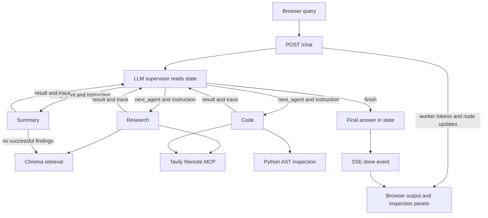

# Architecture and implementation status

Updated: 2026-10-27. Requirements: `Assignment_2_Description.pdf`, especially sections 2, 3, 5, 6, and rubric 7.2, interpreted alongside the TA clarification supplied by the project owner.

## Current scope

Implemented: three specialized workers, an asynchronous LLM supervisor, LangGraph construction, document ingestion/retrieval, Research LCEL generation, Tavily Remote MCP access, fixed provider assignments, and offline tests. FastAPI serves a single-page frontend, `/health`, and `POST /chat` with SSE. Vanilla JavaScript connects the form to streamed worker text, final answers, routing, traces, and citations. Mocked Chrome checks passed at desktop/narrow widths. Three approved document-only browser queries exercised OpenAI and Google through FastAPI: the first exposed rewritten citation IDs, the second confirmed strict rejection but ended with a citation-failure notice, and the third completed successfully after conservative normalization and filtered Supervisor context were implemented. All 26 final citation occurrences linked to supplied evidence in the third run; broader live behavior and claim-level support remain unverified. Deployment remains unverified. Research-only RAGAS measurements are recorded in [evaluation.md](evaluation.md).

## Components and orchestration

| File | Responsibility |
| --- | --- |
| `app/agents/supervisor.py` | Read state, select the next worker or finish through structured LLM output, and record a delegation reason. |
| `app/agents/research.py` | Retrieve document/web evidence and generate grounded findings through LCEL. |
| `app/agents/code.py` | Analyze/generate code with model-selected Python inspection and technical web search. |
| `app/agents/summary.py` | Condense successful findings; retrieve documents when no successful findings exist. |
| `app/agents/citations.py` | Normalize unambiguous document groups and validate document IDs and exact evidence URLs without model calls. |
| `app/agents/agents.py` | Compile the graph and route every completed worker back to the supervisor. |
| `app/agents/state.py` | Define tasks, results, traces, and state reducers. |
| `app/llm.py` | Construct the configured OpenAI or Google model for each role. |
| `app/services/document_rag.py` | Load/chunk PDFs, embed/index them in Chroma, and retrieve evidence. |
| `app/services/tavily_mcp.py` | Discover/invoke Tavily search through Remote MCP and normalize evidence. |
| `app/main.py` | Initialize cached embeddings during lifespan startup, serve static assets and `/health`, and run the graph through `POST /chat` with SSE. |
| `app/schemas.py` | Validate chat input and define routing, citation, trace, and stream envelopes. |
| `app/static/app.js` | Send queries, incrementally parse SSE, and render responses plus per-turn inspection panels. |
| `app/static/style.css` | Provide responsive layout, response whitespace preservation, and readable citation links with keyboard-focus styling. |



This is a central supervisor pattern. Each worker has a distinct prompt and tool-access combination. Research selects document/web channels from its delegated retrieval mode. Code can inspect Python syntax/structure without executing supplied code and can request technical web references. Summary uses supplied findings or document retrieval and has no web-search tool. The supervisor does not count toward the three-specialist requirement. The diagram describes implemented graph wiring, not verified deployed execution.

### State and routing decisions

| Contract | Fields and behavior |
| --- | --- |
| `AgentTask` | `agent`, `instruction`, optional `retrieval_mode`, `search_query`, and `allowed_domains`. |
| `AgentResult` | `agent`, `instruction`, `content`, `success`, `error`, optional structured `sources`. |
| `TraceEvent` | `node`, `action`, `detail`, `provider`, `model`, `reason`, optional `tool`. |
| `ResearchState` | `user_query`, `current_task`, `next_agent`, `results`, `final_answer`, `iteration`, `max_iterations`, `trace`, optional persistent `allowed_domains` and `required_agents`. |

The supervisor context reads `user_query`, `iteration`, `max_iterations`, and a filtered view of `results`. Successful results retain their findings and sources. Failed results expose only agent, instruction, `success=False`, error, and an empty content field; failed sources and rejected findings are omitted from the model context. Original results and evidence remain unchanged in graph state for inspection. This matches the final validator's successful-worker evidence policy. The LLM selects `next_agent`, an instruction, a reason, a research retrieval mode when applicable, and a final answer when finished. It delegates one `current_task` at a time, then reviews the worker result before deciding again; there is no queued task plan. The unused `tasks` state field and `pending_tasks` context entry were removed. The conditional edge reads `next_agent` to dispatch to a worker or end execution.

The Supervisor decision now includes a concise `search_query` and optional `allowed_domains` hostnames. Research sends the separate query to Tavily while keeping its full instruction for generation; older/direct tasks without a query retain the instruction fallback. Once nonempty domain restrictions are established in state, subsequent decisions inherit them rather than broadening them. Restrictions and the selected Research query appear in trace details. Choosing domains from a natural-language official-source request remains an LLM responsibility; deterministic filtering enforces the resulting metadata, not the semantic interpretation of the original request.

After every worker, the supervisor LLM reviews accumulated results and chooses again. There is no fixed Research -> Code -> Summary sequence. Its prompt asks it to consider alternatives after failures and avoid unnecessary delegation. At the iteration limit, code ends the workflow with an incomplete-results notice. This limit does not synthesize a partial answer. The TA clarification allows state-based dispatch after an LLM-generated plan without consulting the LLM after every worker; our approach retains an LLM decision after every worker, trading additional calls and latency for reconsideration based on returned evidence.

The first existing structured decision extracts explicitly requested specialists into `required_agents`; even an empty list persists unchanged. The prompt excludes ordinary verbs, negated requests, and quoted text. Context derives `pending_agents` (never attempted) and `failed_agents` (attempted without any successful result) from results, without storing duplicate status. Natural-language extraction remains LLM-dependent; mocked tests verify enforcement of extracted requirements, not semantic extraction accuracy.

When a finish decision leaves pending specialists, the same Supervisor model gets one reconsideration with the pending list and original evidence. It still selects the worker; code does not impose a sequence. A `completion_reconsideration` trace records this additional generation. Captured requirements and domain restrictions survive the second decision. If it still finishes, the answer becomes a deterministic incomplete-work notice. If a required specialist failed, a finish returns a factual failure notice rather than a completion claim; successful intermediate findings remain inspectable in results. A later successful attempt satisfies that specialist. No automatic worker retries are added.

Ordinary Supervisor turns make one application-level generation invocation; premature completion allows at most two per turn. Both count as one supervisor iteration, so the default eight-turn budget permits at most sixteen application-level Supervisor invocations (SDK retries remain separate). The iteration limit is checked before model construction and permits no reconsideration once reached. These changes have offline coverage only; a new paid retest needs separate approval.

`results` and `trace` use additive reducers; workers return only new entries. The unused shared `messages` field was removed; workers construct their model messages locally. LangGraph message streaming uses model callbacks and does not require a shared conversation-history field. TypedDict shapes do not enforce runtime validation; supervisor decisions use Pydantic structured output and workers validate their delegated tasks.

### Failure handling

All three workers catch ordinary exceptions, return `success=False` with safe error text, and preserve collected evidence. Research fails on missing evidence instead of generating unsupported findings. Research and Summary reject blank output, normalize unambiguous combined references, and validate document IDs before appending source inventories. Validation failures clear generated content while retaining evidence in state and source inspection events; the Supervisor model receives failure details without those failed findings or sources. Both document and web references are checked before appending source inventories. Code validates final document citations and prose URLs too; URLs inside fenced/inline code are excluded from its web citation check so example endpoints are not mistaken for evidence. Code reports tool errors back to its model and bounds execution to ten model turns/ten tool calls. Worker cancellation propagates to the caller.

Worker failure results return along the normal edge to the supervisor, where their status and error remain visible in its filtered context. Persistent full-graph tests now verify that a model failure in each worker reaches the next supervisor decision and ends with an honest failure response. These tests use real nodes and graph routing with mocked model/retrieval boundaries; they do not prove live decision quality or successful completion through an alternative worker. The supervisor's own model/configuration exceptions are not caught; worker failure isolation does not imply that provider failures at the supervisor are handled.

## Fixed provider routing

| Role | Default provider/model | Dimension and design rationale |
| --- | --- | --- |
| Supervisor | OpenAI / `gpt-5.1` | Capability-based: structured delegation, interpretation of returned evidence/failures, and final grounded synthesis. The supervisor also writes final answers, so its responsibility extends beyond classification. |
| Research | Google / `gemini-3.5-flash-lite` | Cost-based: routine generation over retrieved evidence; keep repeated research calls economical while grounding them in supplied sources. |
| Code | OpenAI / `gpt-5.1` | Capability-based: code reasoning and tool-assisted analysis, including choosing inspection/search tools. |
| Summary | Google / `gemini-3.5-flash-lite` | Cost-based: concise condensation of supplied findings/evidence without independent web research. |

The overall policy is hybrid: capability-oriented orchestration/code work and cost-oriented evidence processing/summarization. These are design rationales, not measured proof that one provider is cheaper or more accurate for this workload. Exact pricing and comparative latency/quality remain evaluation work. Settings/environment overrides can change assignments; changing them requires keeping rationale and verification consistent.

Per the TA clarification and assignment section 6, fixed providers per agent are acceptable. Provider routing occurs through the supervisor's choice of agent; dynamic provider selection for every call is optional. A normal Supervisor -> Research -> Supervisor or Supervisor -> Summary -> Supervisor path calls both OpenAI and Google when generation succeeds. A direct finish, a code-only path, or a worker failure before generation may use only OpenAI. Both providers must demonstrably participate in normal deployed use; merely configuring them or using OpenAI as an offline evaluator is insufficient.

Current trace events carry provider/model and a reason. Worker `llm_started` reasons explain the role's cost-based or capability-based assignment, including each repeated Code model turn. Supervisor decision events include its capability-based provider rationale alongside the LLM's original delegation/source-selection or finish reason. The iteration-limit event has no provider/model because no generation occurs on that branch. The endpoint emits these call records as `routing` events, and the frontend displays them by turn. They arrive after the node returns its trace, rather than at call start. Offline tests check supervisor rationale, graph call records, and endpoint routing payloads. The approved local live query demonstrated both providers and their browser routing records on a Supervisor -> Research -> Supervisor path; deployed execution and broader query coverage remain pending. Dynamic per-call provider routing is optional.

## Document RAG

The selected corpus contains 15 distributed systems PDFs (including Raft, GFS, Spanner, Borg, MapReduce, and PBFT): 249 text-bearing pages and 1,891 chunks. Local indexing and two live Research evaluations are recorded in [evaluation.md](evaluation.md). The ignored `data/` directory is not bundled in Git; corpus attribution/acquisition and reproducible submission packaging remain required.

`load_chunks()` recursively reads PDFs with `pypdf`, ignores symlinks/other extensions and blank pages, and splits each page independently into up to 800 characters with configured overlap 120. Corrupt PDFs, PDFs requiring a nonempty password, and textless PDFs fail ingestion; there is no OCR. Metadata preserves corpus-relative `source`, title, 1-based PDF file page, `source_kind`, document/chunk IDs, and page-relative start offset. Example citation ID: `raft.pdf:p7:c1`. IDs identify positions, not historical content versions.

Local `sentence-transformers/all-MiniLM-L6-v2` embeddings run on CPU with normalized vectors and a cached model instance. FastAPI lifespan initializes this model before accepting requests using `await asyncio.to_thread(get_embeddings, settings.embedding_model)`. Retrieval reuses the existing cache. Initialization may download weights if assets are missing; deployment must package cached model assets rather than depend on a startup download. `ingest_documents()` manually re-embeds all chunks in batches of 64, prepares vectors before writes, upserts current IDs, then removes stale IDs. Failed writes can leave a partial rebuild; run ingestion while requests are stopped. A changed embedding-model name requires a new collection name. Retrieval rejects missing/empty indexes rather than ingesting during requests.

Defaults: `CORPUS_DIR=./data/corpus`, `CHROMA_PERSIST_DIR=./data/chroma_index`, `CHROMA_COLLECTION=technical_documents`, `RETRIEVAL_TOP_K=10`. Relative paths resolve against the project root. Retrieval uses a LangChain Chroma retriever, keeps ranked matches first, and adds at most one continuation per match: the next same-page chunk, otherwise the first chunk of the immediately following PDF page in the same paper. Results are deduplicated, preserve metadata, and contain at most 20 chunks at the default k. There is no relevance cutoff or reranking. The continuation strategy and measured trade-offs are documented in the evaluation report.

Research source modes are `documents` (default), `web`, and `both`. The supervisor selects the mode and explains it; Research enforces it. In `both`, document retrieval precedes web retrieval. A channel exception fails the worker without automatic fallback, preserving previously collected sources. An empty channel can be combined with evidence from the other channel; no evidence skips generation.

The Research LCEL chain is `RunnableLambda(retrieve_evidence) | prompt | RunnableLambda(generate_findings) | StrOutputParser()`. Retrieval returns `research_context`: JSON containing the original query, delegated instruction, mode, and normalized sources. The human template is `{research_context}`. The system prompt treats sources as untrusted data, restricts factual claims to supplied evidence, requests exact citation IDs/URLs and available titles/PDF pages, and requires acknowledgment of missing support. Model construction occurs only after evidence exists.

Sources preserve text and metadata in `AgentResult.sources`. Research and Summary append source inventories; Summary also preserves sources from successful findings. Source preservation and citation presence do not establish entailment. The successful offline graph test verifies retained evidence and a citation through Research, Code, Summary, and final state using mocked model responses. A supervisor unit test also verifies that a supplied final answer/citation is returned unchanged. These checks do not prove that live models preserve citations; document identifiers are not yet document-serving URLs.

The live browser query exposed a final-answer formatting failure: the Supervisor compressed document IDs into ranges or combined several IDs inside one bracket pair. The frontend correctly refused to treat those rewritten strings as exact source IDs. Supervisor, Research, and Summary prompts now require separate exact document IDs and forbid ranges/combined references. All three now invoke shared deterministic normalization followed by validation in `app/agents/citations.py`.

`normalize_document_citations(content, sources)` splits a comma-separated bracket group only when every full ID exactly matches a supplied document source, for example `[raft.pdf:p5:c4, raft.pdf:p5:c5]` becomes `[raft.pdf:p5:c4] [raft.pdf:p5:c5]`. Surrounding whitespace around list members is trimmed. Exact IDs, including filenames containing commas, are preserved. Ambiguous groups remain unchanged for validation: no range expansion, abbreviated-ID inference, fabricated-ID repair, or use of web-only IDs. A combined group whose document filename itself contains a comma may remain unrepaired; the function deliberately avoids guessing. Normalization does not modify evidence, add model calls, or retry generation.

`validate_document_citations(content, sources)` accepts exact bracketed IDs only from sources marked `source_kind="document"`. It requires at least one exact reference when document evidence exists and rejects other bracketed references containing `.pdf:p`, including fabricated IDs, ranges, combined IDs, altered case, or added whitespace. Research and Summary normalize and validate model text before adding their source inventories, so an appendix cannot satisfy the inline-reference requirement. The Supervisor normalizes and validates final text against evidence from successful worker results; on failure it returns a fixed citation-failure notice and a `citation_validation_failed` trace, without retrying generation.

`validate_web_citations(content, sources)` checks prose HTTP(S) URLs against exact supplied web URLs, including query strings and fragments. Invented or altered URLs fail even when another valid citation is present. At least one evidence URL is required when web sources exist. Normal sentence/Markdown delimiters are handled without changing source URLs. Code alone excludes fenced and inline code from this check; a URL only inside an example does not satisfy the prose citation requirement. The Supervisor validates against successful-worker evidence within any persistent allowed-domain restriction and uses a general source-citation failure notice.

Research and Summary allow one citation-only regeneration after a document or web citation validation error. The second attempt receives the original evidence, rejected answer, and validation error and must remove unsupported claims rather than invent references. Retrieval is not repeated, the same model object is reused, and `citation_repair_started` plus another `llm_started` event records the additional invocation. A second invalid answer fails the worker while preserving sources. Blank output, provider errors, retrieval errors, timeout, and cancellation do not start a repair loop. Research's two generation attempts share one generation timeout; Summary's attempts share its existing operation timeout. These are at most two application-level generation invocations per worker run, not a guarantee of two HTTP requests: the existing provider SDK retry policy is unchanged. Code and Supervisor do not add citation-repair calls.

Reference validation does not prove claim-level entailment, relevance, or citation coverage for every claim. Document recognition still uses the `.pdf:p` marker and is not a general citation parser. Web validation does not require citing every supplied URL. Invalid workers may already have streamed intermediate text; validation/repair cannot retract it. The first four fixes were subsequently retested live with three passed cases and one partial browser workflow, as recorded below. Web source IDs now equal their exact URLs and all four agent prompts request bracketed [URL] citations. This later identity/prompt change has offline and mocked-browser verification only; explicit retrieval-status context remains separate planned work.

### Offline retrieval timing and startup initialization

Two fresh-process diagnostics used cached assets, offline Hugging Face/Transformers settings, and a socket audit hook blocking network connections. No connections were attempted and no provider APIs were called. In each process, the same query returned the same 16 chunk IDs across three retrievals. These are local Windows timings, not Cloud Run or statistical performance benchmarks.

| Stage | Observed time |
| --- | ---: |
| Import document RAG module/dependencies | 4.98-5.11 seconds |
| First complete retrieval including lazy initialization | 26.4954 seconds |
| Embedding initialization inside that first retrieval | 25.9553 seconds |
| Separately measured `sentence_transformers` lazy imports in second process | 24.8467 seconds |
| Model construction after those imports | 0.9845 seconds |
| Repeated retrievals | 0.1518-0.1810 seconds |

The first-process Chroma opening time includes model initialization: 26.4321 seconds, of which 25.9553 seconds was embedding initialization. Query embedding took 0.017-0.040 seconds across both processes; search/continuation work was approximately 0.006-0.028 seconds. Nested times must not be added together. These measurements identify a substantial lazy-import cost and motivate moving initialization outside the worker timeout; they do not establish the precise cause of the earlier live timeout. Temporary scripts/reports are `csci599-retrieval-timing.py`, `csci599-retrieval-timing-report.json`, `csci599-retrieval-import-timing.py`, and `csci599-retrieval-import-timing-report.json`.

Startup now logs embedding initialization and elapsed time, awaits the loader on a thread, and yields lifespan control only on success. A loading exception propagates and prevents application startup. The existing `lru_cache` supplies the same model to subsequent retrievals; no extra model registry, configuration flag, or dependency is added. This moves cost into startup, including for web-only requests, and does not eliminate cold-start time. Chroma is still opened during retrieval, no corpus ingestion or warm-up query occurs at startup, and the first actual embedding computation remains in retrieval. Cloud Run startup readiness/time budgets and packaged model assets must be validated during deployment. The new startup behavior has mocked offline tests and the real offline lifespan verification below. Later local browser runs below exercised live chat after this change; Cloud Run startup remains unverified.

Actual offline startup verification then exercised the real FastAPI lifespan and `/health` through TestClient with cached model assets. It did not start a listening uvicorn server. The external network was blocked by a socket audit hook, with offline model settings enabled. The first harness attempt stopped before lifespan because the guard blocked the loopback socket pair Windows needs for asyncio. The corrected run allowed literal loopback addresses only: one loopback connection occurred and zero external connection attempts occurred.

| Real offline startup check | Observed result |
| --- | ---: |
| Application/test-client imports before lifespan | 11.0907 seconds |
| Embedding initialization within lifespan | 26.3355 seconds |
| Startup context entry including initialization | 26.3748 seconds |
| First document retrieval after startup | 0.4283 seconds |
| Retrieved chunks | 16 |
| Health status after startup | HTTP 200 |

The embedding cache had one miss and one model instance at startup completion. An explicit identity check confirmed the cached instance was the startup-loaded model. Retrieval increased cache hits without adding a miss. Thus real cached assets initialized before requests and retrieval reused the model. Import, startup, and nested initialization times must not all be added together; total measured process work was 37.9066 seconds. This one local run verifies the lifecycle/cache behavior, not the exact cause of earlier timeouts or deployed latency. No LLM/provider/Tavily APIs, corpus ingestion, or new model downloads occurred. Temporary artifacts: `csci599-startup-warmup.py` and `csci599-startup-warmup-report.json`.

Research retrieval and generation each have `RESEARCH_TIMEOUT_SECONDS` (default 60). Code and Summary each use that setting for their worker operation. Chroma calls use `asyncio.to_thread`; cancellation cannot forcibly stop underlying thread computation. The provider factory sets a 30-second timeout and two retries. Embedding-model initialization now occurs before requests, outside these worker timeouts. These are not a whole-workflow deadline.

## Tavily Remote MCP sharing

`search_web()` uses a request-scoped Streamable HTTP transport and `ClientSession`: initialize, list tools, select a supported Tavily search tool, invoke it, normalize results, and close resources. Authentication uses `https://mcp.tavily.com/mcp/?tavilyApiKey=<encoded-key>` with credentials outside source control. Tavily timeout defaults to 30 seconds. Discovery handles one tool page and checks expected argument names/types, not arbitrary schemas or discovery pagination.

`search_web()` accepts optional allowed-domain hostnames. Hostnames are normalized and validated before connection. If the discovered tool advertises `include_domains` as a direct string array or an `anyOf` union containing a string-array branch, the restriction is sent to the server; otherwise no unsupported argument is sent. Returned source hosts are always filtered locally before applying the result limit. Only the exact host or a subdomain is accepted, so `python.org.evil.com`, `notpython.org`, userinfo, and query-string lookalikes cannot satisfy `python.org`. Disallowed nonempty results fail without broadening the restriction or retrying the search; genuinely empty results remain empty. Code also excludes inherited findings containing out-of-domain web evidence.

Evidence retains HTTP(S) URLs, snippets, titles, and optional metadata; exact URLs are deduplicated. Web `source_id` now equals the exact retrieved URL, including query parameters and fragments. It is independent of result order or which agent/search retrieved it. Two different URLs no longer collide as `web-1`, while repeated retrieval of the same exact URL keeps one identity. URLs are not rewritten or canonicalized, so genuinely different URL strings remain different IDs. Result count defaults to five, titles are capped at 500 characters and snippets at 6,000. Selected transport log filters suppress Tavily endpoint/key-marker records; this is not universal credential redaction.

MCP tool sharing is already implemented: Research calls `search_web()` for web grounding, and Code exposes `search_technical_web`, which calls the same `search_web()` implementation for programming references. Both invoke Tavily through Remote MCP. Separate request-scoped connections do not prevent tool sharing; a common persistent session or A2A layer is unnecessary. Summary has no MCP access. Code's web restrictions are prompt instructions, not a deterministic permission gate.

The offline sharing test runs the actual Research and Code nodes through the actual shared client, mocking only LLM generation and transport/session I/O. Both initialize separate sessions, discover and invoke `tavily-search` with distinct queries, preserve evidence URLs, and record the same remote tool name in their agent traces. Code also receives Research evidence and adds its own web evidence. This verifies the existing architecture rather than introducing sharing. The minimal live check and seven-case batch below subsequently verified local remote connectivity and actual tool selection by both agents. The subsequent four-case retest below exercised domain/query/citation/repair changes live, with three passed cases and one partial workflow. URL-based IDs added afterward remain verified offline and with mocked Chrome only; deployed invocation remains unverified.

## Application and deployment boundary

`Settings` reads root `.env` plus environment overrides. `validate_runtime()` exists but startup does not call it. Each chat request starts fresh graph state; the application claims no durable conversation memory. The browser retains visible turns for the current page, but does not send earlier turns as model context. Chroma index persistence is separate from conversation state. Linux/amd64 image packaging, dependencies, bundled model/index assets, and local offline smoke checks are verified. Cloud Run deployment and cold/warm behavior remain unverified.

### Chat/SSE execution

`ChatRequest` accepts a string of 1-12,000 characters, trims surrounding whitespace, and rejects whitespace-only input. Invalid requests return HTTP 422 before graph construction. `POST /chat` compiles a graph per request and runs `graph.astream()` with `stream_mode=["messages", "updates"]`, an eight-turn Supervisor iteration budget, and a recursion limit of 20. Each turn can include one bounded completion reconsideration as described above. The supervisor awaits structured model generation with `ainvoke()`; workers already use asynchronous generation.

- `messages` supplies model fragments through LangGraph callbacks during generation. The endpoint forwards worker `AIMessageChunk` text as `token` events. It excludes Supervisor structured control output, tool argument chunks, non-text blocks, and completed non-chunk messages. Supported models can stream through these callbacks even when the worker awaits `ainvoke()`. The approved live query verified Google Research generation reaching the browser through this path; other workers' live streaming remains unverified.
- `updates` supplies the deltas returned by every completed node. Workers return only new result/trace entries, so additive state reducers do not cause history to be replayed. The endpoint translates these deltas into `trace`, `routing`, and `citation` events. Worker text can arrive before the corresponding stored trace/routing explanation. Research retrieval itself produces no model text.
- A `start` event identifies the normalized query. After graph execution finishes, `done` supplies the authoritative Supervisor `final_answer`. This final structured answer is delivered whole, while intermediate worker generation is streamed. The implementation does not claim incremental streaming of the Supervisor's final answer.

Every SSE message carries a `StreamEvent` JSON envelope with `type` and `data`; the SSE event name matches `type`. Dedicated models shape trace/routing/citation payloads, while the envelope's `data` dictionary is not a validated union. `EventSourceResponse` provides framing, keepalive comments, and disconnect handling. The stream disables caching. Unexpected graph errors produce a safe `error` event rather than exposing exception text; missing/empty final answers also produce `error`. A stream already started retains HTTP 200, so clients must inspect terminal events. Cancellation propagates; in-flight retrieval threads cannot be forcibly stopped.

Citation events preserve source ID, corpus path or web URL, available chunk ID/PDF page, and excerpt. Deduplication is scoped to one request and keyed by location plus source ID. Repeated web evidence with the same exact URL/ID emits one citation event per request; distinct URLs emit distinct events. The endpoint also retains its existing behavior for legacy/custom source IDs. Evidence may come from failed workers and should not be interpreted as independently verified support for the final answer.

### Frontend rendering

`app.js` uses POST `fetch()` and a streaming reader. `TextDecoder` handles split UTF-8 characters; a buffer waits for complete LF/CRLF SSE frames, combines data lines, and ignores keepalive comments. An interrupted stream without `done`/`error`, malformed JSON, an HTTP error, or an unexpected content type is shown as a failure. Controls are disabled during a request, duplicate submissions are ignored, and controls are restored in `finally`.

Worker fragments are grouped by agent within a turn and labeled as intermediate output. Repeated calls to the same agent append to that agent's working-output section; the trace/routing panels retain individual call records. `done` creates a separate final-answer section. Inspection panels retain collapsible groups for each visible turn. Failed requests mark partial output as incomplete.

Generated content uses `textContent` or text nodes, not HTML interpretation; Markdown/code fences remain plain text. With URL-based web IDs, the existing bracketed-reference renderer maps `[exact URL]` to its source excerpt just as it maps document IDs. No frontend source change or new dependency was necessary. All four agent prompts now request this bracketed web citation format; bare URLs are not converted automatically, so live model adherence remains a verification item. Known unambiguous `[source_id]` references in the final answer link to expandable source excerpts. Ambiguous IDs are not linked to a guessed source. Only HTTP(S) source locations receive external links, with `noopener noreferrer`; local document references link to evidence in the page, not a PDF-serving route. Mocked browser checks verify basic rendering and delayed SSE delivery. The third live document-only query verified streamed Research output, final-answer rendering, and exact citation links for that request. Accessibility, other live worker paths, and deployed network timing remain unverified.

Response paragraphs use `white-space: pre-wrap` to preserve generated line breaks. The message container and welcome text use normal whitespace so HTML indentation does not create large blank areas. Citation links use light blue for both unvisited and visited states, a lighter hover color, and a visible keyboard-focus outline. These targeted CSS fixes retain the existing layout and add no dependencies.

## Verification and shared environment

Application execution, offline tests, answer collection, and RAGAS scoring share Python 3.13 `.venv` and `requirements.txt`. Consolidated pins include OpenAI SDK 2.54.0, jiter 0.14.0, pydantic-settings 2.16.1, python-dotenv 1.2.4, and LangChain Community 0.3.31 (retaining a module RAGAS 0.4.3 imports). The consolidation previously passed clean-environment offline checks, RAGAS imports, graph compilation, and provider/tool construction. The local live query subsequently exercised OpenAI Supervisor and Google Research calls under the shared environment. Historical RAGAS scores were not regenerated; consolidated live scoring and other integrations remain unverified.

The latest full offline suite passed **279 tests in 13.18 seconds** after nullable MCP domain support and completion-guard regressions. The earlier URL-based web ID, bracketed-URL prompt, and identity/SSE regression suite passed **265 tests in 12.83 seconds** on 2026-10-27. The focused MCP/client-sharing/chat suite passed **61 tests in 1.15 seconds**. The previous four-fix suite passed 263 tests in 11.56 seconds, including 40 cases beyond the earlier 223-test suite. The focused new suite passed **33 tests in 0.43 seconds**. Earlier startup verification passed 190 tests in 10.84 seconds. The focused health/chat suite passed **21 tests in 0.73 seconds**. Earlier citation verification passed 187 tests in 22.12 seconds; these timings are not a controlled comparison. The focused Supervisor/graph/citation suite passed **68 tests in 10.59 seconds**; Research/citations passed **69 in 12.74 seconds**, and Summary/citations passed **56 in 9.40 seconds**. Focused totals overlap and must not be added together. Coverage includes health/static serving, PDF ingestion and real temporary Chroma with fake embeddings, Research LCEL/modes/failures/citations, continuation retrieval, Code inspection/tool-loop failures, Summary grounding/citations/failures, answer collection, and the checks below. External generation/retrieval boundaries are mocked. Direct MCP client tests now mock transport/session I/O while checking lifecycle, discovery/argument handling, SDK result parsing, timeouts/cancellation, cleanup, safe errors, and log filters. They do not exercise real HTTP framing, a running MCP server, discovery pagination, or full JSON Schema validation. Offline results do not demonstrate live-model citation compliance or deployed MCP sharing.

| Added test file | Cases | Verified behavior |
| --- | --- | --- |
| `tests/test_health.py` | 7 | Health/static endpoints, embedding initialization before requests, startup waiting without blocking the event loop, and propagation of initialization failure. |
| `tests/test_supervisor.py` | 37 | Failed-result filtering, evidence/citation validation, delegation metadata, persisted requirements (including empty lists), bounded completion reconsideration, honest failure/incomplete notices, successful retries, and iteration limits without model construction. |
| `tests/test_citations.py` | 49 | Strict reference identity, safe combined-reference normalization, unchanged evidence, idempotence, comma-containing IDs, and continued rejection of unsupported groups. |
| `tests/test_research.py` | 35 | LCEL evidence flow, source modes, failures/cancellation, citation rejection before the appendix, and successful normalization with one generation call. |
| `tests/test_summary.py` | 20 | Supplied findings/direct retrieval, evidence preservation, failures/cancellation, citation rejection, and successful normalization before the appendix. |
| `tests/test_agent_graph.py` | 9 | Real graph and workers with mocked external boundaries: evidence/citation/trace propagation, failures returning to Supervisor, skipped Summary recovery, bounded incomplete termination, and required-worker failure reporting. |
| `tests/test_tavily_mcp.py` | 49 | Fake-key URL encoding, session ordering, compatible tool selection, direct/nullable domain arguments, advertised/required arguments, result formats, URL/metadata preservation, evidence limits, safe errors, timeout/cancellation cleanup, and sensitive-log filtering. |
| `tests/test_mcp_sharing.py` | 1 | Real Research/Code nodes and shared client invoke the same discovered tool using distinct queries, preserving evidence and traces with mocked external I/O. |
| `tests/test_chat.py` | 15 | HTTP input rejection; SSE framing; real graph/LCEL with streaming fake generation; routing/traces/citations; output filtering; per-request citation deduplication; safe errors and missing answers; a token yielded before graph completion. |

`tests/conftest.py` provides an autouse fixture that mocks only the `get_embeddings` name imported by `app.main`, so lifespan cannot load/download models in normal tests. Retrieval tests retain their own mocks/fake embeddings; the shared fixture does not replace `document_rag.get_embeddings`. The new startup tests exercise actual lifespan with controlled mock loading. The normal suite made no paid calls and did not load real models. A separate offline lifespan diagnostic loaded cached model assets, as documented above.

The graph test's mocked supervisor reads actual accumulated results before returning its next decision. This verifies state propagation and dispatch, not whether a live LLM chooses the right agent. The success path checks that source text/page metadata survive all workers and that both configured provider labels appear in call traces; mocked labels are not evidence of real provider requests. The failure paths also check that private provider exception text is not exposed in graph output. `git diff --check` passed after the test additions.

JavaScript syntax passed `node --check app/static/app.js`. A one-off Node DOM harness checked byte-split UTF-8/SSE, keepalive comments, intermediate/final rendering, routing/traces, source links, text safety, repeated turns, duplicate submissions, invalid input, stream/HTTP/JSON errors, and control recovery. The harness was not added as a persistent test and does not replace a real browser check. The endpoint timing test directly consumes the response generator while graph completion is gated; TestClient's buffered response alone does not establish incremental browser delivery. No paid calls were made for frontend or endpoint verification.

Headless Chrome smoke tests then loaded the repository's HTML/CSS/JavaScript from a temporary localhost fixture server at verified viewport widths of **1280** and **390** pixels. A delayed mocked `/chat` response verified worker text appearing before the final answer, Unicode display, routing/trace panels, citation expansion and HTTP(S) links, safe literal rendering of script-like text, retained turn history, failure messaging, and restored controls. Both widths passed without horizontal overflow. Screenshots were inspected, revealing welcome-text whitespace and link-color problems; after the CSS fix, the same browser checks passed, with computed-style checks for normal welcome whitespace, preserved response line breaks, and the citation-link color. Updated screenshots were also inspected. This was not a comprehensive accessibility or cross-browser test.

The browser fixture bypassed FastAPI and all provider/retrieval services; its two requests per viewport exercised one success and one error. The real FastAPI/graph path is separately covered by offline endpoint tests. The temporary browser harness and screenshots are local artifacts, not persistent repository tests or submission evidence. Restricted browser subprocesses initially failed; the checks succeeded with the browser running outside that restriction. No provider APIs were called.

### Mocked browser verification of URL citation links

After changing web `source_id` to the exact URL, a temporary local fixture served the repository's unchanged HTML/CSS/JavaScript to headless Chrome. Checks passed at verified viewport widths of **1280** and **390** pixels. A delayed mocked SSE response supplied one document source and two web sources from separate simulated searches, including a URL with query parameters and a fragment. All three final bracketed references became links to the correct existing evidence elements; clicking each expanded its source. Both web source links retained their exact destinations. An unknown URL reference stayed plain text rather than linking to a guessed source.

The same run verified intermediate text before final completion, Unicode, literal rendering of script-like text, routing/trace panels, responsive wrapping without horizontal overflow, citation colors, failure recovery, and retained turn history. Both screenshots were inspected. There were four mocked chat requests total (success and failure at each width), with no provider/Tavily calls. This fixture bypassed FastAPI; persistent endpoint tests separately verify URL source IDs, SSE preservation, repeated-worker deduplication, and final-answer preservation. The MCP sharing test now also checks the real client's URL IDs surviving Research/Code evidence flow, with external I/O mocked. A pure extraction regression checks stable IDs across reordered search results and distinct IDs for different URLs.

Local temporary artifacts: `csci599-web-citations-smoke.py`, `csci599-web-citations-desktop.png`, and `csci599-web-citations-narrow.png`. Browser subprocess execution required permission outside the sandbox, but the page used only a local mocked endpoint. This is not live-provider formatting evidence or comprehensive accessibility/cross-browser verification.

### First approved live document-only browser check

On 2026-10-27, one explicitly approved query ran through Chrome at 1280 pixels, the real local FastAPI endpoint, LangGraph, Chroma/local embeddings, and actual provider APIs:

> Using only the provided corpus, briefly explain Raft leader election and cite the paper and PDF page.

The temporary harness blocked web tools, forced embedding assets to remain offline, disabled provider retries, and capped model invocations at six. These were test safeguards, not production configuration changes. Exactly one chat request and three successful generation calls occurred; no Tavily or paid embedding requests were made.

| Call | Provider/model | Input tokens | Output tokens | Model-call seconds |
| --- | --- | ---: | ---: | ---: |
| Supervisor delegation | OpenAI / `gpt-5.1` | 541 | 179 | 3.898 |
| Research synthesis | Google / `gemini-3.5-flash-lite` | 5,681 | 584 | 2.149 |
| Supervisor final answer | OpenAI / `gpt-5.1` | 6,416 | 557 | 6.620 |

Usage was captured from model callbacks: OpenAI totals **6,957 input / 736 output tokens**; Google totals **5,681 input / 584 output tokens**. These are observed usage counts, not verified bills or a dollar estimate. Provider prices were not checked during this run, so dollar cost is not reported.

Browser-observed total time was **68.857 seconds** and first nonempty worker text appeared at **60.699 seconds**. Much of the pre-generation wait coincided with local retrieval/model initialization; retrieval and model-loading durations were not separately instrumented, so no precise stage attribution is claimed. This was a single local run, not warm-latency evidence or a Cloud Run cold-start measurement. Worker timeouts and provider calls succeeded, but latency remains a follow-up concern.

The browser displayed both providers' routing records, streamed Research text, **18 source excerpts**, and a final answer. However, only **one final citation linked**: the Supervisor rewrote several IDs into ranges such as `[raft.pdf:p5:c4–c5]` or combined brackets. Thus transport/routing/rendering worked, while complete citation-link preservation did not. The second live query below exercised the stricter validator and exposed a further recovery limitation. Nonfatal SDK warnings included ignored Gemini temperature and Pydantic serialization warnings for structured Supervisor output.

The harness, screenshot, and JSON report (`csci599-live-chat-report.json`) reside in the local temporary directory and are not bundled with Git. This run did not exercise Code, Summary, Tavily MCP sharing, live failure recovery, full citation entailment, or deployment. It supplements the Research evaluation in [evaluation.md](evaluation.md), rather than replacing its measurements.

### Second approved live citation check

On 2026-10-27, the same document-only query ran once through Chrome/FastAPI/LangGraph with web tools blocked, embedding assets offline, provider retries disabled, and at most six model invocations. A restricted Chrome attempt failed before page load and made no model calls; the actual query completed with Chrome outside that restriction. These safeguards did not change production configuration.

The citation check **failed**. Initial Research retrieval timed out. The Supervisor delegated another document attempt, which retrieved **16 chunks** and generated findings containing combined bracket references. Strict validation rejected Research output, clearing its stored findings but retaining sources. At that time, the Supervisor still received failed-worker sources and attempted a cited final answer from them. Its successful-worker-only validator rejected that answer and returned the fixed citation-failure notice. The browser displayed intermediate Research text, 16 source excerpts, and **zero linked final citations**. This demonstrates rejection behavior, not successful citation recovery or answer completion.

| Call | Provider/model | Input tokens | Output tokens | Model-call seconds |
| --- | --- | ---: | ---: | ---: |
| Supervisor first delegation | OpenAI / `gpt-5.1` | 708 | 189 | 4.167 |
| Supervisor retry delegation | OpenAI / `gpt-5.1` | 839 | 279 | 4.173 |
| Research synthesis | Google / `gemini-3.5-flash-lite` | 5,234 | 772 | 2.841 |
| Supervisor finish | OpenAI / `gpt-5.1` | 5,430 | 726 | 8.582 |

One chat request made **four generation calls**: OpenAI totals **6,977 input / 1,194 output tokens**; Google totals **5,234 input / 772 output tokens**. No Tavily or paid embedding calls occurred. Usage was captured by callbacks; dollar cost was not calculated. Browser total time was **108.847 seconds**, with first worker text at **98.237 seconds**. The initial retrieval timeout is confirmed by the trace, but retrieval/model initialization durations were not separately measured. Do not infer its exact cause or treat this as a warm-latency or Cloud Run measurement.

After this failed check, safe normalization was added to Research, Summary, and Supervisor, and failed findings/sources were removed from the Supervisor model context while preserved in state. These changes have the offline verification above; the third browser check below subsequently verified successful document-only execution and final citation links. No automatic model repair/retry loop was introduced. The Supervisor can still choose another delegation within its iteration budget. Claim-level support, live Summary/Code behavior, and live/deployed MCP sharing remain unverified.

The local temporary artifacts are `csci599-live-citations.py`, `csci599-live-citations-report.json`, and `csci599-live-citations.png`; they are not bundled with Git. The screenshot was inspected and confirmed combined references remained visible in intermediate streamed Research output. The final fallback was verified from the browser DOM and report. Nonfatal Gemini sampling and Pydantic structured-output serialization warnings recurred.

### Third approved live citation check

On 2026-10-27, one approved repeat of the same Raft document-only query ran through the real local FastAPI/LangGraph/Chroma application and Chrome at 1280 pixels. The harness blocked Research/Code web tools, kept embedding assets offline, disabled provider retries, and capped generation invocations at six. No production settings or source files were changed for the run.

The browser citation check **passed**: Supervisor -> Research -> Supervisor made exactly **three generation calls**, retrieved **17 chunks**, and returned a substantive final answer with **26 linked document citation occurrences**. Browser DOM checks confirmed every bracketed PDF reference in the final answer linked to an existing source element. There were no Research failures, citation-validation failures, or retrieval timeouts. Controls were restored and both providers' routing records appeared. This verifies reference identity and link targets for one query, not claim-level entailment, relevance of every reference, brevity, or general reliability.

| Call | Provider/model | Input tokens | Output tokens | Model-call seconds |
| --- | --- | ---: | ---: | ---: |
| Supervisor delegation | OpenAI / `gpt-5.1` | 751 | 166 | 3.345 |
| Research synthesis | Google / `gemini-3.5-flash-lite` | 5,419 | 526 | 2.056 |
| Supervisor final answer | OpenAI / `gpt-5.1` | 6,293 | 592 | 6.877 |

Callback usage totals: OpenAI **7,044 input / 758 output tokens**; Google **5,419 input / 526 output tokens**. Dollar cost was not calculated. No Tavily calls, paid embedding calls, or provider retries occurred. Browser total time was **47.261 seconds**; first worker text appeared at **39.024 seconds**. The preceding retrieval timeout did not recur in this run, but its cause is unresolved. These measurements include local initialization and are not a warm-latency benchmark or Cloud Run evidence.

The current code ran successfully, but this check did not capture raw pre-normalization final output, so it does not prove normalization actually rewrote an ID group. No failed workers occurred, so failed-result context filtering remains verified offline rather than by this live success path. Code, Summary, MCP sharing, live failure recovery, and deployment were not exercised. Nonfatal Gemini sampling and Pydantic serialization warnings recurred.

Artifacts remain in the local temporary directory: `csci599-live-citations-normalized.py`, `csci599-live-citations-normalized-report.json`, and `csci599-live-citations-normalized.png`. The screenshot was inspected; its viewport shows intermediate output and trace. The final answer and all citation targets were checked through the browser DOM and report, not inferred from that screenshot. Previous failed-run artifacts were preserved. No additional live query was made during this documentation update.

### Live MCP verification and seven-case batch (before the first four grounding fixes)

A minimal approved MCP search requested one result and used no LLM. The sandboxed attempt failed; the network-enabled attempt discovered `tavily_search`, returned an official Python documentation source, and completed in 3.679 seconds. No automatic retries were added. Local report: `csci599-live-mcp-network-report.json`.

The subsequent explicitly approved seven-case batch used real providers, Tavily Remote MCP, five direct-worker scenarios, and two real Chrome/FastAPI workflows. Limits were 28 generation invocations and nine searches, with one result per search and provider retries disabled. Actual usage was **20 generation calls and seven searches**. The reviewed outcomes were two passed, three partial, and two failed:

| Case | Reviewed result | Evidence/limitation |
| --- | --- | --- |
| Research web only | Partial | Search/generation worked, but the returned source did not establish the latest stable release. Research acknowledged insufficient evidence but incorrectly said no search occurred. |
| Code technical search | Passed | Called Tavily, cited the returned official URL, and proposed an explicitly unexecuted asyncio example. |
| Dedicated MCP sharing | Partial | Both agents invoked `tavily_search` with distinct queries. Research received zero results and failed honestly; Code succeeded. |
| Research documents + web | Failed | Retrieved 16 document chunks and one etcd source; generated document citations failed validation. Rejected model text was not retained, so the exact invalid reference is unknown. |
| Summary | Failed | Omitted its supplied URL and failed validation. It used web-only findings because the mixed-evidence Research run had failed; mixed-source summarization was not verified. |
| Full browser workflow | Partial | All three specialists and both providers ran. Research and Code both invoked the same Tavily tool. Summary failed once and was delegated again. Final text cited an unsupplied URL and described a third-party source as official. |
| Document-only browser | Passed | No Tavily invocation; 18 sources and eight linked document citations. Completed in 10.520 seconds, with first worker text at 4.650 seconds. |

The browser workflow completed in 33.674 seconds with first worker text at 7.930 seconds. Its ten generation calls include another Summary delegation after a worker failure; this was Supervisor recovery, not an SDK retry. Automated completion assertions initially passed cases 1 and 6, but manual review downgraded them for relevance/attribution defects. Local MCP sharing and failure recovery were demonstrated; answer correctness and deployed behavior were not established.

Observed usage: OpenAI **23,516 input / 2,482 output tokens** over 13 calls; Google **18,805 input / 1,849 output tokens** over seven calls. Dollar cost was not calculated. All provider invocations completed; worker validation still rejected some outputs. Temporary artifacts: `csci599-seven-live.py`, `csci599-seven-live-report.json`, `csci599-seven-case-6.png`, and `csci599-seven-case-7.png`. Both screenshots and the browser final answers/traces were inspected. No paid cases were rerun to obtain a better outcome. The first four fixes above were implemented afterward with mocks; their live behavior remains unverified.

### Four-fix live retest (before URL-based web IDs)

The approved retest had caps of 20 generation calls and five Tavily searches, requested one result per search, disabled provider retries, and did not automatically rerun failed cases. Actual use was **10 generation calls and four searches**. Raw model responses and actual MCP arguments were captured in the temporary harness to diagnose failures.

| Retest | Reviewed outcome | Observed behavior |
| --- | --- | --- |
| Restricted web Research | Passed | Concise query and docs.python.org restriction; one official source with its exact URL, one generation call, 7.034 seconds. The returned documentation was Spanish; no language restriction had been requested. |
| Documents + restricted web Research | Passed | 17 document chunks plus an etcd source. First generation omitted the web URL; one citation-only repair added it without a second search. Two generation calls, 40.945 seconds including local initialization. The source was etcd v3.1 documentation, not proof of current-version guidance. |
| Summary | Passed | Used successful mixed evidence, preserved both citation kinds, and needed no repair. One generation call, zero searches, 2.715 seconds. |
| Full browser workflow | Partial | Research and Code both invoked Tavily with persistent docs.python.org restrictions. Final URLs matched evidence and no citation validation failed, but Supervisor skipped the explicitly requested Summary specialist. Web citations were still plain text before the identity change. Six generation calls, two searches, 26.274 seconds. |

At the time of this retest, the discovered `include_domains` schema was `anyOf[array-of-string, null]`, but the client recognized only a direct array, so no server-side domain argument was sent; local hostname filtering remained enforced. Subsequent code now supports that nullable schema, with offline tests; requested-agent completion was also added afterward. Both changes still need live verification. This retest demonstrates successful citation repair and mixed-source Summary preservation for these requests; it does not prove claim-level correctness or reliable source freshness.

Observed token totals: OpenAI **8,407 input / 1,141 output** over five calls; Google **25,330 input / 1,628 output** over five calls. Dollar cost was not calculated. Local artifacts: `csci599-four-fix-retest.py`, `csci599-four-fix-retest-report.json`, and `csci599-four-fix-retest-case-4.png`. The report, raw outputs, traces, and screenshot were inspected. The subsequent URL-based ID/prompt change was verified offline and with mocked Chrome, without another paid retest.

```powershell
py -3.13 -m venv .venv
.\.venv\Scripts\python.exe -m pip install -r requirements.txt
.\.venv\Scripts\python.exe -m pytest -q -p no:cacheprovider
.\.venv\Scripts\python.exe -m app.services.document_rag
```

Ingestion is an explicit operation after supplying the corpus, not part of pytest. Pytest excludes `live` by default. Paid/quota-limited tests require separate explicit approval. This documentation update made no paid API calls. The separately approved browser runs verify only the limited live paths described above. The later batch and retest verify local Tavily and Code/Summary execution with the documented limitations. Cloud Run and the subsequent URL-based ID/prompt change remain unverified live.

## Remaining work

Release preparation added a Python 3.13 Linux Dockerfile, explicit application/corpus
copies, build-time local embedding/index creation, offline runtime model settings,
non-root serving, and `PORT` handling. `.dockerignore` excludes local indexes,
evaluation outputs, secrets, and personal notes. `README.md` documents setup and
an unexecuted Cloud Run/Secret Manager recipe; `PROCESS_LOG.md` is an owner-review
draft. Docker was initially unavailable; the subsequent Linux/amd64 build and local
smoke verification succeeded. No cloud resources or paid APIs were invoked.

The first Linux build selected unused CUDA dependencies through PyTorch. It was
stopped, and the Dockerfile now installs pinned `torch==2.14.1` from the official
CPU-wheel index before the shared requirements. The resulting version is
`2.14.1+cpu`. Build-time ingestion embedded all 15 documents and 1,891 chunks.
The earlier single-stage image size was 784,153,694 bytes (about 748 MiB). A temporary container without
API keys ran as UID 10001; homepage and `/health` returned HTTP 200. A direct
document query returned 18 chunks, including `raft.pdf:p6:c4`. Runtime model loading
used cached weights with offline mode enabled. `pip check` found no broken
requirements. Embedding warm-up logged 29.28 seconds on this local run; this is
not total container startup, warm-request latency, or Cloud Run cold-start evidence.
The temporary smoke container was stopped after verification. The Python suite
was not rerun for this Dockerfile-only runtime adjustment; its latest result is below.

The Dockerfile was subsequently converted to a multi-stage build, matching
assignment section 4.2. `base` provides Python 3.13, `libgomp1`, shared settings,
and the non-root account. `build` installs CPU-only dependencies and ingests the
corpus. `runtime` copies the installed Python environment, application, Chroma
index, and embedding cache. Original PDFs stay in the build stage; FastAPI creates
an empty corpus directory at startup, but serving queries uses the bundled index.

The multi-stage Linux/amd64 image built successfully at **750,490,613 bytes
(about 716 MiB)**. A temporary container without API keys used injected `PORT=8090`,
mapped to localhost port 8088. Homepage, `/health`, and `/static/app.js` returned
HTTP 200. Direct retrieval returned nonempty chunks with citation metadata;
CPU-only PyTorch, UID 10001, offline model settings, 1,891 indexed chunks, zero
original corpus files, and `pip check` were verified. An initial assertion that
the corpus directory itself would not exist was corrected after checking the
startup-created empty directory; no application change was needed. Embedding
warm-up logged **29.80 seconds** in this run. This remains a local initialization
measurement, not deployed TTFT or a cold/warm benchmark. The temporary container
was stopped. No paid APIs or cloud resources were invoked, and the Python suite
was not rerun for this Dockerfile-only change. README and process-log updates
remain separate documentation steps.

Latest full offline execution: **279 passed in 13.18 seconds** after nullable MCP domain support and release preparation. The focused MCP/sharing suite passed **50 tests in 0.87 seconds**. Local Chroma inspection confirmed 1,891 chunks in `technical_documents` with matching embedding-model metadata, without loading embeddings or invoking providers. The preceding completion-guard suite passed 275 tests. `git diff --check` passed. No paid API calls were made for these changes.

- **P0 - Routing evidence:** Demonstrate both providers in the deployed application and retain inspectable call records. One local live document query already exercised OpenAI and Google with browser routing records; fixed assignments remain valid and dynamic per-call routing is optional.
- **P0 - Orchestration verification:** The completion guard for extracted explicit specialist requirements is implemented and tested offline; live natural-language extraction and recovery remain unverified. Continue verification of worker-failure handling and the latest URL-based citation format. Corrected final citation links passed for one local document-only query; this does not establish general live reliability. Further paid calls require separate approval.
- **P0 - MCP evidence:** Sharing is implemented and verified offline. Local remote transport and actual Research/Code invocation are demonstrated by the approved live checks. Retain equivalent evidence in deployment and retest the new restrictions under a separately approved live budget.
- **P0 - Delivery:** Linux image packaging, bundled model/index assets, and local offline smoke checks are verified. Deploy on Cloud Run and verify deployed arbitrary-query behavior. A local document-only FastAPI/provider/browser path and mocked responsive UI checks are complete, subject to the citation limitation above. Finalize README and process-log deliverables.
- **P0 - Evaluation and reproducibility:** Document corpus acquisition/attribution, retain reproducible artifacts, and finish provider comparison, token/cost estimates, retrieval/LLM/total latency, TTFT, and cold/warm deployment measurements. Existing Research RAGAS results are already recorded.
- **P1 - Reliability:** Startup now moves the measured lazy embedding initialization outside request timeouts. Verify real startup and deployment timing, and investigate any recurring retrieval timeout before changing timeout settings. Review supervisor API failure handling, deterministic tool restrictions, context/workflow cost bounds, retries, and citation entailment limitations as integration proceeds.
